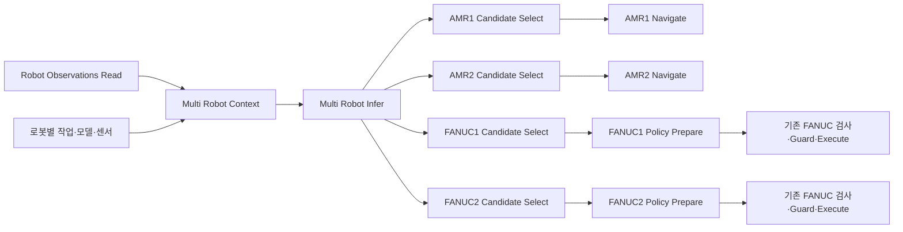

# 같은 씬의 여러 종류·여러 로봇: 월드 상태부터 병렬 추론까지

하나의 `WorldState.robots[]`에 모든 로봇을 보관하고, 인스턴스별 작업·모델·센서를 명시적으로 연결한다. 같은 FANUC M-710iC/20L 두 대도 서로 다른 prim 경로와 entity ID로 구분한다. 전체 세계 상태를 공유하되 선택한 로봇의 관측과 명령 대상은 각각 유지한다.



## 실행 예제

[4대 로봇 설정 예제](../examples/isaacsim/multi_robot_world_model.example.json)의 prim·articulation 경로, 실제 관절 이름, 바퀴·차체 크기, Stage 식별자와 점유 지도를 현재 씬에 맞게 수정한다. [AMR 실행 가이드](amr-live-world-model-ko.md)의 launcher에서 `VLAGRAPH_WORLD_MODEL_CONFIG`를 이 설정 파일로 지정한다. 브리지 코드를 교체한 뒤에는 Isaac Sim에서 이전 Python 모듈이 남지 않도록 프로세스를 다시 시작해 새 코드를 로드한다.

[다중 로봇 추론 그래프](../examples/graphs/multi_robot_world_inference_graph.json)를 JSON import로 불러온다. 예제는 AMR1·AMR2·FANUC1·FANUC2를 대상으로 한다. AMR은 로컬 격자 경로 계획을 사용하고, 두 FANUC는 기존 `openvla-stub`에 독립된 추론 요청을 보낸다. 기본 AMR 실행은 미리보기이며 FANUC 결과는 Print로 확인한다. Stub은 배선 확인용 delta 후보를 반환하므로 FANUC 실행용 관절 궤적으로 사용할 수 없다.

| 노드 | 기능 |
| --- | --- |
| Robot Observations Read | 같은 물리 스텝에서 로봇들을 읽고 `world_state`와 로봇별 `navigation_maps`를 출력 |
| Multi Robot Context | 관측한 인스턴스에 작업·모델·센서·지도를 연결하고 월드 버전·digest를 고정 |
| Multi Robot Infer | 최대 8개 worker로 독립 추론. 기본 4개. 요청마다 자기 로봇 상태와 전체 로봇·객체 문맥을 전달 |
| Robot Candidate Select | prim 경로로 결과를 선택하고 원래 월드 버전·신선도를 확인. 해당 로봇을 선택한 WorldState 출력 |
| FANUC Policy Prepare | 명시적인 FANUC 관절 궤적 후보를 로봇 설정에 바인딩하고 기존 사전검사 수행 |

모델 응답은 로봇별 성공·실패로 보관한다. 기본 `requireBatchSuccess: true`에서는 한 로봇의 추론 실패나 AMR 경로 충돌이 있으면 모든 선택 노드가 명령 전달을 막는다. 독립 작업으로 취급할 때만 해당 선택 노드에서 이 값을 끈다.

## 로봇별 모델 바인딩

`Multi Robot Context.robotBindings`는 다음 형식의 배열이다. 모델 이름만으로 로봇 종류·관절·실행 방식을 추측하지 않는다.

```json
[
  {
    "robot_prim_path": "/World/AMR1",
    "robot_kind": "amr",
    "provider": "amr_grid",
    "action_schema": "vlagraph.amr_plan.v1"
  },
  {
    "robot_prim_path": "/World/FANUC1",
    "robot_kind": "articulated_arm",
    "provider": "openvla",
    "model_name": "my-fanuc-policy",
    "endpoint": "http://my-policy-service:9060",
    "action_schema": "vlagraph.fanuc_m710ic20l.action.v1",
    "require_image": true
  }
]
```

`provider`는 `amr_grid`, `openvla`, `gr00t`를 지원한다. `endpoint`는 `/infer`를 제외한 서비스 주소이며 생략하면 기존 모델 라우팅 설정을 사용한다. GR00T는 해당 로봇에 학습된 `embodiment_tag`를 반드시 지정한다. G1 태그나 디코더를 다른 로봇에 자동 적용하지 않으며 실패한 모델을 다른 모델·stub으로 자동 대체하지 않는다. 일반 VLA의 delta·action chunk를 FANUC 관절 궤적으로 임의 변환하지 않는다.

GR00T에는 `state_joint_groups`도 지정한다. 예를 들어 `{"joint_positions": ["J1", "J2", "J3", "J4", "J5", "J6"]}`는 모델의 `joint_positions` 상태 벡터에 실제 관측한 J1~J6을 이 순서로 연결한다. 모델의 처리기·학습 데이터가 이 키·차원·단위와 embodiment를 지원해야 한다. 다중 로봇 요청은 `require_complete_state: true`를 보내며, HTTP 어댑터는 다른 로봇 설정으로의 fallback과 누락 상태의 평균값 대체·padding·truncation을 거부한다. 요구한 카메라를 읽지 못하면 검은 이미지로 대체하지 않는다. 이 검사는 기존 단일 로봇 요청과 구분되는 opt-in 동작이다.

작업 배열 `robotTasks`는 인스턴스 경로와 `instruction`을 지정한다. AMR에는 Z-up 월드 미터 단위 `goal_m: [x, y]`도 지정한다. 작업 하나당 로봇 하나를 명시하고 중복 할당을 거부한다. 작업을 받지 않은 로봇도 공유 세계의 다른 로봇으로 계속 포함된다.

## 센서와 관측 버전

학습형 추론은 기본적으로 해당 로봇에 연결된 카메라 관측을 요구한다. `sensors` 입력은 prim 경로별 사전이며 아래 값은 실제 프레임 수집기가 제공해야 한다.

```python
sensors = {
    "/World/FANUC1": {
        "robot_prim_path": frame["robot_prim_path"],
        "image": frame["image"],
        "observed_at": frame["observed_at"],
        "episode_id": frame["episode_id"],
        "scene_version": frame["scene_version"],
        "sim_time": frame["sim_time"],
    }
}
```

기본 카메라 최대 수명은 2초이며, 월드와 에피소드·씬 버전·로봇 경로가 같아야 한다. 시뮬레이션 시각이 있는 경우 차이는 0.1초 이하여야 한다. 오래된 프레임에 현재 시각을 붙여 신선한 관측으로 만들지 않는다. 기존 단일 카메라 패킷을 여러 로봇에 복사해서 사용할 수 없다. 로봇별 카메라를 수집하는 센서 소스에서 이 계약을 제공해 연결해야 한다. `require_image: false`는 이미지 없이 추론할 수 있는 서비스나 예제 stub에 명시적으로 사용한다.

공통 월드 참조에는 씬·Stage·씬 버전·에피소드·상태 버전·시뮬레이션 시각·관측 시각·digest가 포함된다. 모든 병렬 요청은 같은 참조를 사용하며 각 요청의 선택 로봇·이미지·작업은 분리한다. 결과 선택 시 월드가 바뀌었거나 관측이 5초보다 오래되면 다시 수집·추론해야 한다. 느린 정책 응답이 자동으로 현재 상태에 적용되지는 않는다.

모델 요청의 구조화된 `state`에는 자기 로봇과 공유 세계를 함께 전달한다. 기존 서비스가 일부 상태 필드만 읽는 경우에도 세계 문맥이 전달되도록 instruction에도 공유 관측을 데이터로 첨부한다. 이 입력 경로를 연결했다고 모델이 다중 로봇 계획을 학습했거나 정확히 추론한다는 뜻은 아니며, 모델별 평가가 필요하다.

## 동시 제어 연결

AMR 브리지는 `active_commands[robot_prim_path]`로 명령을 관리한다. 서로 다른 AMR의 경로 추종을 같은 update에서 진행하고, 정지·도착·관측 오류를 로봇별로 처리한다. 한 로봇에는 활성 명령 하나만 허용하고 같은 articulation을 여러 활성 인스턴스가 공유하는 것을 거부한다. Stage 교체·시뮬레이션 리셋·브리지 종료는 전체 AMR에 적용한다. 서로 다른 세션이 같은 씬을 사용할 때 Cancel Run은 자신이 등록한 command ID만 정지한다.

AMR의 전체 경로 통로가 다른 활성 AMR의 예약 통로와 겹치면 두 번째 요청을 거부한다. 같은 추론 배치의 AMR 후보끼리 겹쳐도 실행 전에 실패로 표시한다. 이는 시간 예약·양보 협상이 없는 보수적인 공간 예약이며 자동 우회·대기 순서 최적화는 제공하지 않는다. 독립된 통로에서는 여러 AMR을 동시에 주행할 수 있다. 네트워크 명령들이 정확히 같은 물리 스텝에 시작한다는 보장은 없다.

FANUC의 `candidate`와 선택한 `world_state`를 `FANUC Policy Prepare`에 연결하고, 같은 인스턴스의 `Robot Setup.robot_config`를 연결한다. 정책은 선언한 `unit`, J1~J6 `joint_names`, `joint_trajectory`를 가진 `vlagraph.fanuc_m710ic20l.action.v1`·`apply_fanuc_trajectory`를 반환해야 한다. 준비 노드는 모델이 넣은 실행 허용 플래그를 사용하지 않으며 기본은 미리보기다. `enableExecution`을 명시한 뒤에도 준비된 `action`과 `report`를 기존 `Execution Guard`에 연결해야 한다. Robot Setup은 Guard와 Robot Execute에도 동일하게 연결한다. `full` 정책의 미구현 물리 예측 차단은 유지한다.

여러 FANUC를 실행하려면 각 인스턴스를 처리하는 제어 어댑터·브리지 주소를 각각 연결해야 한다. 기존 단일 로봇용 FANUC 브리지의 같은 포트로 여러 팔의 명령을 보내는 기능은 이번 변경에 포함되지 않는다. 여러 팔의 동시 제어는 인스턴스별 전용 제어 연결을 전제로 한다. 학습 후보는 준비·검증 전까지 실행 허가가 아니다.

## 검증과 남은 범위

자동 테스트는 같은 모델의 두 팔에 서로 다른 작업·이미지를 보내는 병렬 HTTP 요청, 월드 버전·인스턴스·센서 불일치 거부, 모델별 실패 격리, 네 로봇 그래프 연결, FANUC 준비·기존 Guard, 두 AMR 동시 update와 개별 정지·오류·리셋, 두 세션의 정지 소유권을 확인한다. 모델 HTTP 응답과 물리 상태는 테스트에서 대체했으므로 실제 학습 모델의 정확도와 Isaac Sim PhysX 동시 주행은 검증하지 않았다.

현재 `prediction_ready`는 계속 `false`다. 여러 로봇의 미래 궤적을 물리 rollout으로 비교하는 예측기, 팔과 AMR의 미래 작업 공간 충돌, 공유 자원 배정·작업 의존성·동기화된 dispatch, 전체 로봇을 묶는 실행 전 일괄 승인·실행 후 오차 학습은 별도 계층이 필요하다.
