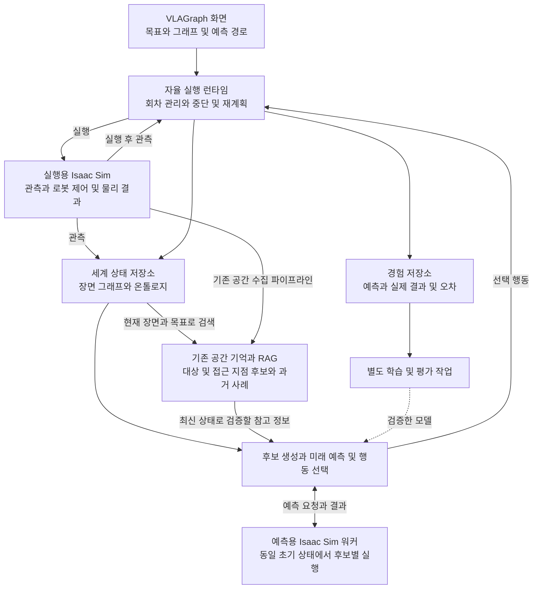

# VLAGraph Omniverse 자율형 월드모델 개발 설계

작성일: 2026년 10월 15일  
수정일: 2026년 10월 27일<br>
상태: 다종·다중 로봇 관측·병렬 추론 및 AMR 동시 제어 기반 구현, 물리 예측·실환경 통합 검증 보류

VLAGraph의 기존 그래프 실행 구조에 세계 상태 관리, 후보 행동의 미래 예측, 행동 선택, 실행 결과 검증을 추가한다. 첫 MVP는 Isaac Sim의 방 안에서 이동 로봇이 장애물을 피해 목표 지점에 도달하고, 예상 이동과 실제 이동을 비교하는 시스템이다.

VLAGraph는 `Spatial Data Collection` 템플릿을 통해 로봇 상태와 장면 객체를 수집하고, 장면 변경을 감지하며 공간 기억을 저장하는 기반을 보유한다. 본 개발은 이 관측·공간 기억 계층을 재사용하고 확장하여 일관된 세계 상태 관리, 행동에 따른 미래 상태 예측, 실행 결과 비교를 연결한다.

현재 구현을 재사용하는 영역과 새로 개발할 영역을 구분한다. 기하 관측 변환, 공간 기억 호환 처리, FANUC 관측·스냅샷·명령 완료 조회는 아래 구현 현황에 명시한 범위까지 구현했다. 나머지 신규 노드, 전체 데이터 계약, 저장소 및 브리지 명령은 구현 대상이며 기존에 제공되는 기능으로 간주하지 않는다.

## 개발 목표와 범위

첫 MVP의 환경은 방 하나, 이동 로봇 하나, 정적 장애물 다섯 개, 목표 지점 하나로 구성한다. 사용자는 목표를 지정하고 실행을 시작한다. 시스템은 관찰, 예측, 선택, 실행, 평가를 반복하며 목표 도달, 정체, 시간 초과 또는 사용자 중단 시 종료한다.

핵심 개발 목표는 다음과 같다.

- 관측한 세계를 일관된 좌표계와 시뮬레이션 시각으로 표현한다.
- 동일한 초기 상태에서 여러 후보 행동의 결과를 예측한다.
- 충돌 조건과 로봇 제약을 만족하는 행동을 선택한다.
- 선택한 행동의 일부 구간을 실행한 뒤 새 관측으로 재계획한다.
- 예측과 실제 결과를 연결해 경험 데이터로 저장한다.

물체 집기와 운반, 동적 장애물, 학습형 예측기는 후속 단계에 포함한다. LLM이나 VLM은 목표 해석과 인식에 연결할 수 있지만, 첫 MVP의 경로 선택과 성공 판정은 구조화된 상태 및 명시적인 조건으로 수행한다.

이 문서의 기본 MVP와 성능 평가는 이동 로봇을 대상으로 한다. FANUC M-710iC/20L과 같은 로봇 팔에는 공통 관측·예측·실행·평가 계약을 재사용하되, 상태와 후보 생성 및 검증 기준을 작업 셀에 맞게 적용한다. 구체적인 범위는 아래 FANUC 작업 셀 적용 절에 정의한다.

## 기존 코드와 확장 지점

현재 `Spatial Data Collection` 템플릿의 흐름은 다음과 같다.

```text
Robot State (Isaac Sim) → Scene Scan → Scene Context Reset → Spatial Memory Save → Print
                                                                  ↑
                                                         Spatial Task Prompt
```

이 템플릿은 장면 관측과 기억 수집을 수행한다. 행동 실행 및 실행 후 관측 노드는 포함하지 않으므로 저장된 기록만으로 작업 성공이나 상태 전이가 검증되었다고 판단하지 않는다. 별도 `Spatial RAG` 템플릿은 저장된 기억을 검색해 모델 프롬프트에 주입한다.

| 영역 | 현재 기반 | 추가 개발 |
| --- | --- | --- |
| 장면 관찰 | `scene_scan`이 브리지에 `scan_scene` 요청 | 관측 시각, 상태 버전, 좌표계 표준화 |
| 장면 변경 감지 | `scene_context_reset`의 장면 식별자·객체 서명 및 검색 캐시 초기화 | 에피소드·상태 버전과 연계, 지도·예측의 무효화 기준 |
| 공간 기억 | `spatial_memory_save`의 JSONL 저장 | 현재 상태와 경험 데이터 분리 |
| 기억 검색 | `spatial_rag_retrieve`의 텍스트와 거리 기반 점수 검색 | 목표, 실패 유형, 환경 조건 기반 경험 검색 |
| 문맥 구성 | `spatial_context_builder` | 장면 그래프와 온톨로지 제약 연결 |
| 행동 실행 | `robot_execute`의 Omniverse 모드 | 명령 상태 조회, 실행 완료 확인, 실제 상태 수집 |
| 그래프 실행 | 위상 정렬을 사용하는 DAG 실행기 | 한 회차의 관찰부터 경험 저장까지 구성 |
| 반복 실행 | 런타임 세션의 반복과 상태 피드백 처리 | 자율 제어 상태 관리와 회차 간 상태 보존 |
| 미래 예측 | 후보 행동을 비교하는 엔진을 신규 개발 | 예측 워커, 상태 초기화, 궤적 평가 |
| 학습 | 기존 VLA 학습 노드 | 전이 데이터 기반 예측기 학습 및 평가 |

관련 코드:

- [그래프 스키마](../backend/schemas.py)
- [그래프 실행기](../backend/runtime/runner.py)
- [런타임 세션](../backend/runtime/session_manager.py)
- [공간 기억 노드](../backend/executors/spatial_nodes.py)
- [행동 실행 노드](../backend/executors/vla_nodes.py)
- [실행 노드 등록](../backend/executors/registry.py)
- [프론트엔드 그래프 타입](../frontend/src/types/graph.ts)
- [Spatial Data Collection 및 Spatial RAG 템플릿](../frontend/src/pages/GraphPage.tsx)
- [Isaac Sim 브리지](../examples/isaacsim/VlaGraphIsaacSimBridge.py)

현재 공간 기억 저장과 검색은 온톨로지 추론이나 미래 상태 예측과 구분한다. 기존 VLA 파인튜닝도 월드모델 예측기 학습과 데이터 및 평가 목적이 다르다.

## 시스템 구성



실행용 시뮬레이터와 예측용 워커는 분리한다. 후보 행동을 시험하는 동안 실행 장면이 변경되지 않아야 한다. MVP에서는 예측 워커 하나가 후보를 순차 평가하고, 이후 측정된 처리 시간에 따라 워커 수를 늘린다.

백엔드는 목표, 후보 선택, 경험 기록을 담당한다. Isaac Sim 브리지는 물리 상태 읽기와 로봇 제어를 담당하고, 예측 워커는 초기 상태 복원과 후보별 물리 실행을 담당한다. 물리 제어의 세부 API는 설치된 Isaac Sim 버전에 맞춘 어댑터 안에 둔다.

## 온톨로지와 세계 표현

| 구성 | 역할 | 예시 |
| --- | --- | --- |
| 온톨로지 | 개념, 관계, 행동의 전제조건 정의 | 이동 로봇은 로봇의 한 종류 |
| 장면 그래프 | 현재 객체와 관계 표현 | 로봇이 방 안에 있음 |
| 세계 상태 | 예측과 제어에 필요한 수치 표현 | 위치, 속도, 충돌 형상, 관측 시각 |
| 경험 | 행동 전후 상태와 예측 오차 저장 | 예상 이동 0.3m, 실제 이동 0.27m |

초기 온톨로지는 다음 개념으로 구성한다.

```text
Entity
├── Robot
│   └── MobileRobot
├── Obstacle
├── GoalRegion
└── Room

관계
  located_in(Entity, Room)
  blocks(Obstacle, Route)
  has_capability(Robot, Capability)

행동
  Move
  Turn
  Stop
```

`Move`의 허용 조건은 이동 능력 보유, 유효한 관측 상태, 속도 제한 준수, 후보 궤적의 충돌 및 여유 거리 조건 만족으로 정의한다. 온톨로지는 행동 조건을 정의하며, 궤적의 충돌 여부는 지도와 예측 결과를 이용해 계산한다.

첫 구현은 JSON 개념 정의와 Python 검증 규칙을 사용한다. OWL 의미론이나 SPARQL이 필요해지면 별도 어댑터를 추가한다. 관측하지 않은 영역은 `unknown`으로 표시하며 장애물이 없는 영역과 구분한다.

현재 `scan_scene`은 USD prim을 순회해 객체 목록을 만들고 `obstacles`는 빈 목록으로 반환한다. 따라서 객체 목록을 바로 장애물 지도에 넣지 않고 다음 규칙으로 정규화한다.

- `world_state_build`는 USD 계층과 모델·물리 속성을 이용해 부모·자식 prim을 물체 단위로 묶고 중복을 제거한다. 원본 prim 경로는 추적용으로 보존한다.
- `scene_graph_update`는 정규화된 물체를 바닥, 정적 장애물, 목표 대상, 기타 객체로 분류하고 공간 관계를 갱신한다. 물리 속성과 명시적인 장면 설정을 우선하며 이름만으로 통행 가능 여부를 확정하지 않는다.
- 시각적 바운딩박스와 물리 충돌 형상을 구분한다. 충돌 형상에서 점유 지도를 생성하고, 근사 형상을 사용할 경우 근사 방식과 여유 거리를 기록한다.
- `maxObjects` 제한이나 필터로 발생한 관측 누락을 메타데이터에 표시한다. 스캔 완료 여부와 관측 범위를 알 수 없으면 빈 영역을 자유 공간으로 확정하지 않는다.

## 데이터 계약

노드 간 월드모델 데이터는 Pydantic 모델로 검증한다. 기존 그래프의 `data` 구조는 설정 전달에 사용하고, 세계 상태와 예측 결과는 명시적인 모델을 사용한다.

| 모델 | 주요 필드 |
| --- | --- |
| `WorldState` | `schema_version`, `scene_id`, `episode_id`, `state_version`, `sim_time`, `frame`, `robot`, `objects` |
| `Goal` | `goal_id`, `target_position`, `position_tolerance_m`, `stop_speed_tolerance_mps`, `max_episode_time_sec` |
| `CandidateAction` | `candidate_id`, `robot_id`, `control_mode`, `controls`, `duration_sec` |
| `Prediction` | `candidate_id`, `source_state_version`, `predictor_version`, `trajectory`, `collision`, `min_clearance_m`, `valid` |
| `ExecutionResult` | `command_id`, `status`, `start_sim_time`, `end_sim_time`, `actual_state`, `error` |
| `Experience` | `episode_id`, `step_id`, `state_before`, `candidates`, `predictions`, `selected_candidate_id`, `execution`, `evaluation` |

`world_state_build`는 기존 스캔을 입력으로 받아 확장하는 어댑터로 구현한다. 기존 필드와 추가 수집 항목의 관계는 다음과 같다.

| 기존 스캔 데이터 | 재사용 및 추가 개발 |
| --- | --- |
| `scene_id`, `stage_identifier`, `root_path` | 장면 출처로 보존하고 별도 장면 버전 및 에피소드 식별자와 연결 |
| `robot`의 `prim_path`와 pose | 로봇 식별자·좌표를 정규화하고 속도, 관절 및 제어기 상태를 추가 수집 |
| 객체의 `name`, `label`, `type`, `prim_path`, `position`, `bbox_center`, `size` | 물체 단위로 통합하고 자세, 물리 속성 및 충돌 형상을 추가 수집 |
| `timestamp` | 수집 당시 시스템 시각으로 보존하고 동일 물리 스텝의 `sim_time`을 별도 수집 |
| `object_count`, 요청의 `max_objects` | 브리지 응답에 관측 범위·잘림 여부·필터 정보를 추가하여 완전성 판단 |

기존 `timestamp`를 `sim_time`으로 간주하지 않는다. 예측에 필요한 필드가 없으면 0이나 빈 목록으로 유효 상태를 가장하지 않고 누락 및 유효성 정보를 전달한다. 원본 스캔은 정규화 결과와 연결해 변환 과정을 추적할 수 있게 한다.

좌표와 시간의 내부 표준은 다음과 같다.

- 위치와 크기: meter
- 각도와 각속도: radian, radian/second
- 세계 좌표: 오른손 좌표계, Z-up
- 자세: quaternion `[w, x, y, z]`
- 물리 시간: 시뮬레이터의 `sim_time`
- 외부 통신 지연: 별도의 단조 증가 시계로 측정

USD 장면의 단위와 up-axis는 브리지에서 읽고 변환한다. 위치, 속도, 충돌 형상, 로봇 크기에 동일한 변환을 적용한다. 객체는 안정적인 식별자를 사용하고 `prim_path`는 장면 내 참조로 함께 저장한다.

동일한 장면 버전에서 같은 물체를 다시 관측하면 식별자를 유지한다. 영속 식별자가 있는 장면은 이를 우선 사용하고, 없는 장면은 정규화한 물체 루트 경로와 장면 버전으로 매핑한다. 물체 재생성·경로 변경 시 동일성이 확인되지 않으면 새 식별자를 발급하고 기존 기억과의 연결을 재검증한다.

각 경험의 키는 `scene_id + episode_id + step_id`로 구성한다. 시뮬레이션 초기화 시 새 `episode_id`를 발급하고, 관측 갱신 시 `state_version`을 증가시킨다. 버전 일치 외에도 관측의 경과 시간을 검사해 오래된 상태의 실행을 막는다.

관측에는 `source`와 `visibility`를 포함한다. 시뮬레이터 정답 상태와 센서 추정 상태를 구분하고, 부분 관측 평가에서는 가려진 객체의 정답 위치를 계획기에 전달하지 않는다.

## 그래프 노드 구성

아래 타입 중 `world_state_build`는 기하 관측 변환까지만 구현했으며, 물리 상태 통합은 남아 있다. `execution_observe`는 FANUC 어댑터의 명령 ID별 상태를 한 번 조회하는 경로를 구현했다. 나머지 타입은 신규 개발 대상이다. FANUC 전용 입력 노드 `fanuc_state_read`, `fanuc_snapshot_read`의 구현 범위와 런타임 연결 상태는 FANUC 적용 절에 기록한다.

| 노드 타입 | 입력 | 출력 | 책임 |
| --- | --- | --- | --- |
| `world_state_build` | 기존 장면 스캔, 추가 물리 상태, 센서 관측 | `WorldState` | 물체 단위 통합, 좌표·시각·식별자 정규화 및 누락 검증 |
| `scene_graph_update` | 세계 상태 | 장면 그래프 | 객체 역할 분류, 장애물 및 공간 관계 갱신 |
| `ontology_validate` | 장면 그래프, 목표, 로봇 능력 | 제약 조건 | 행동 전제조건 확인 |
| `goal_resolve` | 목표, 세계 상태 | `Goal` | 목표 위치와 성공 조건 확정 |
| `action_candidates` | 상태, 목표, 제약 | 후보 목록 | 전역 경로 주변의 단기 행동 생성 |
| `world_predict` | 상태, 후보 목록 | 예측 목록 | 후보별 미래 궤적 계산 |
| `action_select` | 목표, 예측 목록 | 선택 행동과 예측 | 허용 후보 중 비용 최소화 |
| `execution_guard` | 선택 행동, 최신 상태 | 검증된 행동 | 상태 유효성과 실행 제약 재검사 |
| `execution_observe` | 명령 식별자 | 실제 종료 상태 | 완료 상태와 실행 후 관측 연결 |
| `prediction_evaluate` | 선택 예측, 실제 상태 | 오차와 종료 판단 | 같은 시간 구간의 결과 비교 |
| `experience_save` | 상태, 후보, 예측, 실제 결과 | 경험 식별자 | 전이 데이터 저장 |

한 회차의 주 실행 순서는 다음과 같다.

```text
Scene Scan
 → World State Build
 → Scene Graph Update
 → Ontology Validate
 → Goal Resolve
 → Action Candidates
 → World Predict
 → Action Select
 → Execution Guard
 → Robot Execute
 → Execution Observe
 → Prediction Evaluate
 → Experience Save
```

이는 실행 순서이며 각 노드가 바로 앞 노드의 출력만 받는다는 의미는 아니다. 세계 상태는 후보 생성, 예측, 실행 검증, 평가 및 저장 노드에 직접 연결한다. 선택 예측과 실제 종료 상태도 평가 노드에 별도로 연결한다.

기존 `scene_context_reset`은 스캔 이후의 장면 변경 감지에 재사용하고, 변경 시 해당 장면의 지도와 검색 캐시 및 기존 예측을 무효화하도록 확장한다. `spatial_memory_save`는 관측 기록 저장 분기로 연결하며, 검증된 행동 경험은 실행 후 `experience_save`에서 저장한다.

기억 활용 분기는 현재 장면과 목표를 `spatial_rag_retrieve`에 전달하고, 검색 결과를 `goal_resolve`와 `action_candidates`의 참고 입력으로 연결한다. `spatial_context_builder`는 목표 해석에 LLM이나 VLM을 사용할 때 문맥 구성에 재사용한다. 이는 기존 프롬프트 주입 방식에서 구조화된 계획 입력으로 확장할 부분이다.

현재 실행기는 순환을 허용하지 않는 DAG이므로 마지막 노드에서 첫 노드로 순환 엣지를 만들지 않는다. 런타임이 한 회차의 그래프를 완료한 뒤 다음 회차를 시작한다. 예측 실패나 `ok: false` 결과는 실행 차단 조건으로 처리하며 유효하지 않은 결과를 실행 노드에 전달하지 않는다.

## 미래 예측과 행동 선택

정적 장애물 MVP에서는 점유 격자에 로봇 크기와 여유 거리를 반영한 뒤 A*로 전역 경로를 생성한다. 단기 후보는 전역 경로 주변의 전진, 회전, 감속, 정지를 조합한다.

RAG로 검색한 대상 객체, 과거 접근 지점, 검증된 실패 사례는 목표 확인과 후보 생성에 참고한다. 최신 관측과 기억이 충돌하면 최신의 유효한 관측을 우선하고, 기억의 좌표는 현재 장면 버전과 객체 식별자가 일치할 때만 변환·검증 후 사용한다. 기억에만 있는 객체의 현재 위치를 확정하지 않는다.

현재 `approach_waypoint`는 로봇과 대상 위치에서 계산한 기하학적 접근 지점이다. 이를 충돌이 검증된 경로나 실제 성공 위치로 취급하지 않는다. 검색된 접근 지점도 지도·로봇 제약·후보 예측 검사를 통과해야 실행할 수 있다. 검색 결과가 없으면 최신 관측에 기반한 계획을 진행한다.

예측기는 공통 인터페이스를 갖는다.

```python
predict(state: WorldState, candidates: list[CandidateAction]) -> list[Prediction]
```

첫 예측기는 Isaac Sim 물리 실행을 이용한다. 이후 학습형 예측기도 동일한 입력과 출력 계약을 구현한다.

초기 실험값은 다음과 같다. 처리 지연과 장면 규모를 측정해 조정하며 성능 보장값으로 사용하지 않는다.

| 항목 | 초기 실험값 |
| --- | --- |
| 후보 수 | 8~16개 |
| 예측 구간 | 1~2초 |
| 실제 실행 구간 | 0.2~0.5초 |
| 예측 워커 | 1개, 순차 평가 |

후보 선택은 제약 검사와 비용 평가로 나눈다. 예측 실패, 충돌, 최소 여유 거리 미달, 제어 한계 초과 후보를 먼저 제외한다. 나머지 후보에서 목표 거리, 경로 이탈, 이동 시간, 제어 변화량을 정규화한 비용의 가중합을 최소화한다. 비용 가중치와 정규화 기준은 실험 설정에 기록한다.

선택한 후보의 첫 구간만 실제로 실행하고 새 관측으로 재계획한다. 모든 후보가 제외되면 정지하고 경로를 재계산한다. 반복적으로 진전이 없으면 `blocked`로 종료한다.

예측 워커는 후보마다 동일한 초기 상태를 복원한다. 복원 범위에는 객체 위치와 속도, 관절 상태, 제어기 상태, 물리 설정 및 난수 설정을 포함한다. USD 파일 저장이나 로봇 위치 복원만으로 전체 물리 상태가 복구되었다고 간주하지 않는다. 정확히 복원할 수 없는 내부 상태의 영향은 반복 실험으로 측정하고 허용 오차를 설정한다.

실제 실행이 예측 구간의 일부일 때는 실제 종료 시각에 대응하는 예측 상태와 비교한다. 예측 구간 전체의 종료 위치를 짧은 실행 결과와 직접 비교하지 않는다.

## 런타임과 브리지 계약

런타임 상태는 다음 흐름을 따른다.

```text
OBSERVE → PLAN → PREDICT → SELECT → EXECUTE
                                      ↓
                              WAIT_COMPLETION
                                      ↓
                              EVALUATE → STORE
                                      ↓
                       다음 회차 또는 에피소드 종료
```

세션은 목표, 지도, 최신 세계 상태 참조, 진행 중인 명령, 회차 번호를 보관한다. 이전 회차의 노드 출력 전체를 다음 회차에 재사용하지 않는다. 오래된 예측이나 실패 결과가 현재 입력에 섞이지 않도록 회차별 계산 결과를 새로 만든다.

| 상황 | 처리 |
| --- | --- |
| 예측 중 실행 장면이 변경됨 | 기준 상태 버전과 시각을 검사하고 예측 폐기 또는 재계산 |
| 전송 후 응답이 끊김 | 명령 상태 조회 후 재전송 여부 결정 |
| 실행 완료 관측이 없음 | 시간 초과 처리, 성공 판정 보류 |
| 관측이 오래됨 | 실행 보류 후 재관측 |
| 목표 반경에 진입함 | 속도 조건과 정지 유지 조건까지 확인 |
| 사용자 중단 | 취소와 정지 요청 후 최종 상태 기록 |

브리지에 추가할 계약은 다음과 같다. 이름은 프로젝트 내부 프로토콜 제안이며 Isaac Sim 기본 API 이름이 아니다.

| 명령 또는 이벤트 | 목적 |
| --- | --- |
| `capture_world_state` | 일관된 물리 스텝의 세계 상태 수집 |
| `load_prediction_state` | 예측 워커의 초기 상태 구성 |
| `rollout_candidates` | 후보별 고정 스텝 실행과 궤적 수집 |
| `execute_action` | 제한된 시간 구간의 행동 실행 |
| `get_command_status` | 명령 진행 및 완료 상태 조회 |
| `cancel_action` | 실행 중 행동 취소와 정지 |
| `action_completed` | 명령 식별자와 실제 종료 상태 전달 |

명령에는 `command_id`, `episode_id`, `expected_state_version`을 포함한다. 동일 `command_id`는 중복 실행하지 않고 기존 상태를 반환한다. 상태는 `accepted`, `running`, `completed`, `failed`, `cancelled`로 구분한다. 명령 수락과 실제 행동 완료를 구분하고, 예측 워커의 명령이 실행용 시뮬레이터에 전달되지 않도록 역할을 검증한다.

기존 `safety_clamp`의 적용 범위를 확인해 재사용하되 경로 전체의 충돌 검사는 별도로 구현한다. 통신 응답의 `ok`나 `applied`는 작업 성공을 의미하지 않는다.

## 저장소와 학습 데이터

MVP는 SQLite로 에피소드, 명령 상태, 세계 상태 참조, 경험 메타데이터를 저장한다. 이미지와 대형 궤적은 파일로 저장하고 데이터베이스에 경로, 형식, 체크섬을 기록한다. 기존 공간 기억 JSONL은 유지하면서 경험 식별자로 연결한다.

새 저장 형식은 `schema_version`과 `record_kind`로 `observation` 및 `experience`를 구분하고, 작업 결과는 `outcome: unknown | success | failure`로 표현한다. 관측 수집 성공과 작업 성공은 별도로 기록한다. JSONL 관측 기록과 SQLite 경험은 관측·경험 식별자로 연결한다.

각 경험에는 다음을 저장한다.

- 실행 전 상태와 목표
- 후보 행동 목록과 모든 유효 및 실패 예측
- 선택한 후보와 선택 사유
- 실제 실행 구간과 종료 상태
- 위치 및 방향 오차, 충돌 여부, 목표 거리 변화
- 예측기, 제어기, 장면, 온톨로지의 버전
- 목표 도달, 정체, 시간 초과, 중단 등 종료 사유

기존 `Spatial Data Collection` 템플릿의 `success: true`와 `spatial_memory_save`의 성공 기본값은 제거했다. 관측만 수집한 기록의 작업 결과는 `unknown`으로 저장하고, 완료 관측과 평가 조건으로 결과가 확인된 경험만 `success` 또는 `failure`로 기록한다. 명령 실패나 완료 관측 누락은 실행 상태에 기록하며, 작업 결과가 확인되지 않았다면 `unknown`을 유지한다.

현재 호환 어댑터가 인정하는 경험 증거는 비어 있지 않은 `scan`과 `action`, `result.status: completed`, `result.actual_state`, `result.evaluation.verified: true` 및 `result.evaluation.outcome: success | failure`다. 실패한 스캔이나 실패 응답은 성공 증거로 인정하지 않는다. 기존 boolean 필드가 필요한 읽기 경로에는 검증된 결과만 `metadata.success: true | false`로 전달하고 미검증 결과는 `null`로 전달한다. 평가 노드 구현 시에는 동일 시각·상태 버전 및 목표 조건의 실제 검증을 이 증거 생성에 연결해야 한다. 현재 어댑터는 입력 증거의 형식을 검사하며 물리적 성공을 자체 계산하지 않는다.

기존 JSONL 원본은 보존하고 읽기 어댑터에서 신규 형식으로 해석한다. 행동과 완료 관측 및 평가 근거가 없는 기존 `success: true` 기록은 `observation`, `outcome: unknown`으로 취급한다. 검색 점수의 성공 가산점은 검증된 성공 경험에만 적용하고, 전후 상태와 행동이 연결되지 않은 기록은 동역학 학습 데이터에서 제외한다. 호환 처리는 저장 노드뿐 아니라 검색 노드와 문맥 구성에도 적용한다.

학습은 별도 작업에서 수행한다. 상태와 행동으로 다음 상태 또는 상태 변화량을 예측하는 모델을 먼저 학습한다. 학습형 예측기는 분리된 평가 장면에서 물리 예측 및 단순 운동학 기준 모델과 비교하고, 검증을 통과한 버전만 활성화한다. 경험 저장이나 검색만으로 정책 개선이 이루어졌다고 판정하지 않는다.

## 코드 배치와 화면

다음 경로는 신규 파일과 모듈의 제안 위치다.

```text
backend/
├── world_model/
│   ├── schemas.py
│   ├── state_builder.py
│   ├── scene_graph.py
│   ├── ontology.py
│   ├── predictor.py
│   ├── planner.py
│   └── evaluator.py
├── executors/
│   └── world_model_nodes.py
├── runtime/
│   └── autonomous_session.py
├── storage/
│   ├── world_state_store.py
│   └── experience_store.py
└── routes/
    └── world_model.py

examples/isaacsim/
├── world_model_room.py
└── prediction_worker.py

frontend/src/
├── types/worldModel.ts
└── components/worldModel/
    ├── PredictionPreview.tsx
    └── EpisodeTimeline.tsx
```

기존 노드 등록, 프론트엔드 노드 타입, Sidebar, Inspector, 그래프 템플릿에도 신규 노드를 연결한다. `backend/config.py`에는 실행 및 예측 브리지 주소, 예측 시간 제한, 관측 유효 시간, 저장소 경로를 추가한다. 임계값과 후보 생성 설정은 실행 시작 시 검증하고 에피소드에 함께 저장한다.

기존 `spatial_nodes.py`, Isaac Sim 브리지, `GraphPage.tsx`의 공간 수집 템플릿은 재사용 및 확장 대상이다. 성공 기본값 정정과 JSONL 읽기 호환 처리는 이 기존 경로에 반영하고, 새 월드모델 모듈은 상태 정규화·예측·평가 책임을 담당한다.

화면에는 후보 경로와 선택 경로, 후보 제외 사유, 예측 종료 위치와 실제 종료 위치, 목표까지 거리, 회차, 예측 및 실행 소요 시간을 표시한다. 사용자는 일시 정지, 재개, 중단과 에피소드 리플레이를 수행할 수 있어야 한다.

## 로봇 설정과 모델 프로파일 분리

2026-10-22에 공통 `robot_setup` 노드를 기존 FANUC Execute에 추가했다. [모델 프로파일](../backend/world_model/robot_profiles.py)에는 관절 원점·부호 축·제한·J6 기준점 오프셋과 모델 ID·revision·출처를 보존한다. [설정 노드](../backend/executors/robot_setup_nodes.py)는 모델 프로파일, 인스턴스 ID, 연결 주소·prim, 작업 셀 준비 설정과 Collection 경로를 묶어 digest가 있는 `vlagraph.robot_config.v1`로 출력한다. 설정 연결이 있으면 노드별 기존 값보다 우선하며, 연결 값이 없거나 잘못되면 과거 M-710 기본값으로 대체하지 않는다.

| 기능 | 구현 범위 | 제한 |
| --- | --- | --- |
| 기본 프로파일 | M-710 수치를 한 프로파일로 분리, 기존 함수와 그래프의 호환 기본값 유지 | 실제 물리 실행 검증은 여전히 보류 |
| 자동 설정 | USD 관절·제한·부호 축 추출 및 독립 USD/FK 바인딩 대조 | 지원 가능한 직렬 J1~J6만 처리. TCP·보정·제어기는 추정하지 않음. URDF 직접 입력은 미구현 |
| 수동 설정 | 프로파일·준비 설정 JSON 입력/불러오기/내보내기, 기본 JSON 다운로드 | boolean·단위별 숫자·축·관절 수·구조·허용 키 검사. 설정 파일은 사용자가 보관하고 다시 불러오는 방식 |
| 공통 전달 | Prepare·Snapshot·Scene Scan·USD Geometry·Collection Context·Guard·Execute에 연결 | 새 템플릿 선택 또는 기존 그래프의 수동 연결 필요 |
| 프로파일 계산 | FK·IK·제한 검사·USD 바인딩·충돌·hull 진단에 선택 구조 적용 | 일반 고정 회전·다축·다른 제조사 컨트롤러는 추가 어댑터 필요 |
| 실행 일치 | action에 프로파일·설정 digest·instance·prim 보존, Guard/Execute 재대조, 실행 중 UI 설정 편집 잠금 | 사용자 정의 모델은 실제 전송 차단. 물리 워커의 원자적 실행 상태 검사는 미구현 |

변경된 모델에 M-710 ID를 재사용하거나 설정에서 실행 허가·Guard 정책을 바꾸는 키를 입력하면 거부한다. 노드 설정 변경으로 digest가 바뀌면 기존 준비 action·검사 보고서를 재사용하지 않는다. 같은 모델의 추가 로봇은 다른 instance ID·prim·연결·작업 셀 보정으로 구분한다. 다른 제조사·이동 로봇·휴머노이드의 선택/실행 어댑터와 프로파일 서버 저장소는 후속 범위이며 이번 구현 완료에 포함하지 않는다.

[사용 방법](fanuc-m710ic20l-isaacsim-template-ko.md#로봇-설정-기본값자동수동)과 [설정 파일 예시](../examples/graphs/fanuc_m710_robot_settings.json)를 제공한다. 자동 USD 지원의 선택 의존성은 [requirements-usd.txt](../backend/requirements-usd.txt)로 분리했다. [2026-10-22 검증 기록](validation/fanuc-robot-settings-2026-10-22.json)은 실제 Test8 USD의 기본/자동/수동 모드 일치와 기존 LS의 전송 차단을 기록한다. 네트워크·이동 명령은 요청하지 않았다. 전체 테스트 336개와 subtest 5개, 프론트엔드 빌드를 통과했다. 새 모델의 실제 호환성·보정·물리 예측 완료를 이 결과로 선언하지 않는다.

## 휴머노이드 G1 월드모델 개발 계획

### 목표와 첫 적용 범위

기존 휴머노이드 동작 추출·리타기팅·G1 실행 경로에 **동기화된 상태 관측 → 후보 행동 예측 → 제약 검사 → 짧은 구간 실행 → 실제 결과 평가**를 연결한다. 이 절은 신규 개발 계획이며 아래 H0~H7 기능이 이미 구현됐다는 의미가 아니다. FANUC 개발 마감과 휴머노이드 월드모델 완료를 별도로 관리한다.

첫 검증 환경은 Isaac Sim의 G1 한 대, 평탄한 정적 바닥, 고정 장애물, 명시적인 목표로 제한한다. 먼저 고정 베이스에서 상체 동작과 명령 완료 계약을 검증한 뒤, 자유 베이스에서 정지 자세 유지·체중 이동·짧은 이동 순으로 확장한다. 고정 베이스 성공을 균형·보행 성공으로 인정하지 않는다. 달리기·점프·계단·동적 장애물·접촉 조작 및 실제 하드웨어 전송은 후속 범위다.

### 기존 구현과 재사용 경계

| 영역 | 현재 코드·기반 | 이번 계획의 확장 |
| --- | --- | --- |
| 동작 데이터 | `backend/motion/extractor.py`의 자세·특징 추출과 휴머노이드 JSONL | 물리 관측과 연결된 상태 전이·실패 레이블 추가 |
| 리타기팅 | `backend/executors/motion_nodes.py`의 G1 목표·궤적 생성 | 실제 articulation 관절 대응·제한·제어 주기 검사 |
| 스킬 해석 | `backend/executors/g1_skill_nodes.py`의 스킬·속도·절차적 궤적 생성 | 기존 출력을 후보 행동으로 취급하고 실행 전 검증 |
| 관절 명세 | `backend/executors/g1_action_schema.py` | 23DOF·허리 3DOF·손 등 실제 자산별 프로파일 대조 |
| 공통 월드 상태 | `backend/world_model/schemas.py`, `state_builder.py` | 자유 베이스·관절·접촉·제어기 상태의 별도 계약 |
| 형상·거리 | `usd_geometry.py`, `convex_distance.py` | 공통 계산·출처 검증 재사용, G1용 링크 바인딩 신규 구현 |
| 그래프·실행 | 기존 G1/Motion Learning/RGB-D Follow 경로와 `robot_execute` | 기존 흐름에 관측·검사·판단·완료 출력을 통합 |

FANUC 전용 FK·관절 제한·레일 처리·Preflight·Guard를 G1에 그대로 적용하지 않는다. 공통 digest·관측 식별·형상 추출 방식을 재사용하고, 자유 베이스 및 접촉을 포함한 G1 검증기를 별도로 구성한다. 영상 landmark·관절 목표·절차적 보행 궤적은 물리적으로 안정된 보행 제어기나 검증된 실제 상태가 아니다. 기존 모방 데이터의 `trainable` 표시는 물리 전이 데이터의 완전성·실행 안정성을 보증하지 않는다.

### 단계별 구현과 완료 기준

| 단계 | 구현 작업 | 검증·완료 기준 | 선행 조건 |
| --- | --- | --- | --- |
| H0 자산·실행 경로 확정 | G1 USD·prim·실제 DOF·관절명·단위·축·질량·관절 제한·구동기·베이스 고정 여부·제어 주기 조사. 기존 명령을 운동학 재생/위치 목표/속도 스킬/정책 제어로 구분 | 자산·제어기 버전이 있는 프로파일 생성. 누락·중복 관절, 가상축, 제한 미설정은 보류로 기록. 절차적 애니메이션을 보행 정책으로 표시하지 않음 | 실제 G1 Stage와 브리지에 대한 읽기 접근 |
| H1 관측·완료 계약 | 동일 물리 스텝의 root pose·선형/각속도·관절 위치/속도·양발 pose·접촉·명령 상태 수집 | 수집 전후 step 일치, 미지원 값 `null`·출처 표시. 재시작·시간 역행 시 episode 변경. 명령별 accepted/running/completed/failed/cancelled 구분과 중복 전송 방지 검증 | H0 |
| H2 실행 전 검사 | 유한 수치·관절 대응·위치/속도/가속도·시간·제어 모드·관측 신선도·동작 범위 검사, G1 Guard 추가 | 잘못된 관절·오래된 관측·동작 중 충돌 명령·Guard 우회·검사 후 action 변경을 전송 전에 차단. 고정 베이스 상체 동작의 명령 완료를 모의 브리지와 실제 시뮬레이터에서 확인 | H0, H1 |
| H3 접촉·균형·충돌 진단 | 발 접촉 상태, 베이스 기울기/높이, 미끄러짐, 지지 영역·질량중심, 전신 자기·환경 충돌 계산 | 정상 발–바닥 접촉과 비의도 접촉을 구분. 접촉 센서·질량 정보가 없으면 진단 미확인. 정지 유지·발 들림·미끄러짐·낙상·몸통 충돌 사례에서 상태를 구분 | H1, H2와 실제 물리 바디·접촉 데이터 |
| H4 격리된 미래 예측 | 별도 Isaac Sim/Isaac Lab 워커에서 같은 초기 상태·제어기로 후보별 짧은 rollout 수행 | 실행 Stage를 변경하지 않음. root·관절·속도·구동기·정책 내부 상태·접촉 이력 등 필요한 초기화 범위를 명시. 복원 오차와 반복 예측 편차 측정, 불완전 복원·시간 초과는 후보 보류 | H1~H3, 자유 베이스용 안정화 제어기 |
| H5 실행·재계획 통합 | 정지·상체 이동·작은 목표 변화 후보를 평가하고 허용된 짧은 구간만 실행, 재관측 후 반복 | 고정 베이스 → 자유 베이스 정지 유지 → 체중 이동 → 짧은 보행 순서로 별도 게이트 통과. 중단·통신 단절·정체·예측 불일치·낙상 시 상태 전이 검증 | H4 및 해당 동작을 지원하는 검증된 제어기 |
| H6 경험 저장·재현 | 전후 관측, 후보·예측·선택 이유·실행 결과·실패와 버전·seed 저장 | 프레임·명령 ID가 연결된 replay 가능. 영상 모방 데이터와 실제 물리 전이를 별도 schema로 저장. 누락 관측·명령 거부·완료 미확인을 성공으로 저장하지 않음 | H1~H5 |
| H7 통합 인수 | 고정 시나리오의 회귀·장시간 반복·성능 측정과 UI 보고서 정리 | 아래 인수 조건을 충족한 동작 범위만 완료로 표시. 미확인 동작·미설정 임계값·예측 없는 실행은 기본 차단 | H0~H6 |

구현 순서는 **H0 → H1 → H2 → H3 → H4 → H5 → H6 → H7**이다. H6의 저장 계약과 시험 fixture는 H1부터 준비하되, 실제 전이 검증 완료는 H5 이후에 판단한다. 첫 구현 묶음은 H0~H2로 제한하여 관측·검사·명령 완료를 먼저 닫는다. 자산·브리지·제어기 정보가 확인되기 전에는 보행 완료 일정이나 실제 실행 가능 상태를 확정하지 않는다.

### 상태·행동·예측 계약

계약명과 아래 파일·노드명은 신규 제안이다. 공통 `WorldState`의 기하 관측과 구별하고 구현 시 버전을 부여한다.

- **관측:** episode·state version·sim time·physics step·관측 시각, robot prim·자산/프로파일/제어기 버전, meter·Z-up 기준과 변환 출처, root pose/twist, 실제 DOF별 위치·속도·목표, 양발 pose와 접촉 바디·힘·미끄러짐, 명령 ID·상태. 질량중심·토크·접촉력은 실제 API의 지원 범위와 측정/추정 여부를 표시한다.
- **행동:** 관절 궤적·속도 스킬·정책 입력을 구분하고 제어 모드, 시작 상태 digest, 명령 ID, 제어/실행 구간, 실제 관절 순서·단위·제약을 보존한다. 관측 시각·축·프로파일이 다르면 변환 또는 거부 사유를 명시한다.
- **예측:** 초기 상태·행동·환경·제어기 digest, 워커·시뮬레이터 설정, 복원 범위·오차, 예측 시계열, 최소 거리·지지/접촉 상태·낙상·목표 오차·시간 초과, 미검증 항목을 보존한다. 하나의 종단 pose만으로 전 구간을 통과 처리하지 않는다.
- **결과:** 명령 접수·완료와 작업 성공을 별도 필드로 관리한다. 목표 오차와 안정 상태 유지 구간을 실제 관측으로 확인해야 성공이다. 정책의 hidden state나 접촉 이력이 복원되지 않으면 동일 초기 상태 예측이라고 주장하지 않는다.

H0에서 로봇·제어기별 관절 한계, 속도/가속도, 허용 기울기·높이, 정지 유지 시간, 관측 유효 시간, 접촉·미끄러짐·충돌 여유와 목표 도달 기준을 설정한다. 값과 근거가 없으면 기본 숫자를 임의로 채워 실행하지 않는다. 정지 자세의 질량중심 투영과 지지 다각형 검사는 참고 진단이며 동적 보행 안정성의 충분조건이 아니다. 발 교대 접촉을 포함한 동적 동작은 해당 제어기의 물리 rollout으로 검증한다. 자유 베이스에서 관절 목표를 단순 동결하는 것을 안전 정지로 간주하지 않으며, 제어기가 제공하는 정지·안정화 동작과 실패 시 처리를 별도로 검증한다.

### 코드 배치와 사용자 흐름

`backend/world_model/humanoid.py`에 관측·행동 계약, `humanoid_preflight.py`에 정적 검사, `humanoid_balance.py`에 접촉·균형 진단, `humanoid_collision.py`에 전신 바인딩·충돌, `humanoid_prediction.py`에 워커 계약을 제안한다. 실제 rollout은 기존 그래프 실행기와 분리된 워커에서 수행한다. `backend/executors/world_model_nodes.py`에 관측·검사·예측·완료 조회를 등록하고 기존 `g1_skill_nodes.py`, `motion_nodes.py`, `vla_nodes.py`와 연결한다. 이름은 구현 시 확정하며 현재 제공되는 API로 취급하지 않는다.

최종 사용자 흐름은 **기존 G1/Motion/RGB-D 입력 → 행동 후보 → 실제 상태 관측 → 검사·예측 → G1 실행 판단 → 기존 Execute → 완료·실제 상태 → 평가·경험 저장**이다. 후보·예측 재생이 필요한 경우에도 실행용 Stage와 분리한다. 화면에는 고정/자유 베이스, 사용 제어기, 관측 품질·접촉·낙상, 예측/실제 차이, 전송 차단 이유를 표시한다. 개발용 테스트 그래프는 허용하되 최종 사용자에게 별도 실행 템플릿을 중복 제공하지 않는다. 기존 RGB-D 스트리밍 경로에도 검사 경계와 과거 프레임 폐기 규칙을 적용해 우회 경로를 남기지 않는다.

### 검증 시나리오와 인수 조건

| 검사 층 | 필수 시나리오 | 판정 근거 |
| --- | --- | --- |
| 오프라인 계약 | 23DOF/허리 변형, 관절 누락·중복·순서 변경, NaN·단위 오류·시간 역행·오래된 상태 | 지원 프로파일만 수용하고 나머지는 명시적으로 거부 |
| 명령·완료 | 중복 ID·다른 action 재사용, 접수 후 실패·단절·취소, 실행 전후 상태 변경 | 재실행·잘못된 완료/성공 승격 없음, 미확인 결과는 미확인으로 유지 |
| 고정 베이스 | 작은 상체 동작·장애물 접근·관절 한계·중단 | 명령 추종·완료·충돌 차단 확인. 균형 성공으로 집계하지 않음 |
| 자유 베이스 | 정지 유지, 체중 이동, 발 들림·미끄러짐·낙상, 안정화 정지 | 접촉·베이스·목표·시간 조건을 실제 물리 관측으로 확인 |
| 예측·실행 대조 | 같은 상태·후보 반복, 장애물과 목표 변경, 워커 실패·불완전 복원 | 위치·자세·관절·접촉 및 실패 예측의 오차와 편차를 기록 |
| 폐루프·보행 | 정지/재계획·정체·통신 단절·짧은 보행, RGB-D 입력 지연 | 제어기 지원 범위의 동작만 허용, 수동 종료·기한 초과·실패 상태 도달 |

H7 시작 전에 자산·환경·제어기 버전, 평가 시나리오·seed·반복 횟수, 목표/안정성 임계값과 예측 지연 예산을 고정한다. 결과는 시나리오별 성공·실패·미확인 횟수, 낙상·비의도 충돌, 목표/예측 오차, 제어 지연으로 보고한다. 회귀 시험에서 Guard 우회·중복 실행·허위 성공이 발생하면 인수 실패다. 안정 보행·목표 도달 성능은 합의한 반복 시험 기준을 충족해야 완료이며 단위 테스트 통과만으로 대체하지 않는다. 기존 296개 테스트는 공통·FANUC·기존 휴머노이드 기반의 회귀 결과이고 H0~H7 인수 증거가 아니다.

## 단계별 개발과 검증

### 현재 구현 현황과 사용 방법

**2026-10-20 마감 상태:** 이번 개발 범위인 FANUC 검사 기반·기존 Execute 통합·일괄 진단 도구의 구현과 회귀 검증을 마무리했다. 전체 테스트 296개와 subtest 5개, 프론트엔드 빌드를 통과했다. [최종 마감 보고서](validation/fanuc-m710-closeout-2026-10-20/summary.json)의 `collection_completed=true`는 6개 검사 단계의 결과 수집 완료이며, `execution_validation_completed=false`, `execution_ready=false`는 실제 실행 검증 보류를 뜻한다. 상세 개발 단계와 전체 자율 월드모델 계획의 미완료 범위는 아래 표를 따른다.

실환경 검증 재개에는 다음 조건이 필요하다.

1. Isaac Sim의 Script Editor에서 [어댑터 연결 스크립트](../examples/isaacsim/AttachFanucWorldModel.py)를 실행하고 스냅샷·형상 조회 성공을 확인한다. 최종 재조회에서도 두 명령은 거부됐다.
2. [입력 양식](validation/fanuc-m710-closeout-2026-10-20/alignment-input-template.json)을 별도 파일로 복사해 같은 TCP 자세의 실측 기준 쌍을 채우고, TCP 규약·외부축 영점·적용 로봇·보정 버전을 검증한다.
3. 원본 LS의 L/CNT 경로·WAIT·공정/IO 의미와 툴·주변 환경 충돌 및 물리 추종·명령 완료를 검증한다. 현재 정적 관절 검사나 기본 상태 조회로 대체하지 않는다.

재검사는 아래 일괄 명령을 **새롭거나 비어 있는 출력 폴더**로 실행한다. 기존 증거 파일의 덮어쓰기를 거부하며, `summary.json`과 사람이 읽을 수 있는 `SUMMARY.txt`를 함께 생성한다. 이 마감에서 로봇 이동·물리 초기화·실행 정책 완화는 수행하지 않았다.

남은 FANUC 검사는 [일괄 검증 도구](../scripts/validate_fanuc_bundle.py)로 모아서 실행할 수 있다. 보정 후보·좌표 정렬 자료·USD 형상·원본 LS·기존 Execute의 차단 경계·선택적 실시간 조회를 수집하며, 한 단계에서 실패해도 독립적인 다음 검사를 계속한다. 아래의 **FANUC 일괄 검증** 절에 실제 결과와 재실행 방법을 기록했다. 일괄 도구 구현 완료와 실제 로봇 실행 검증 완료는 별도 상태다.

| 범위 | 구현 및 검증 현황 | 남은 작업 |
| --- | --- | --- |
| 0단계 공간 기억 | 성공 기본값 제거, 관측·경험 분류, JSONL 읽기 호환, 검증된 성공만 검색 가산점 적용, 실패 스캔 저장 차단 구현 | 실제 Isaac Sim 수집 그래프 실행 및 장면별 객체·단위 확인 |
| 0단계 관측 품질 | 브리지의 Stage 단위·up-axis·스캔 범위·잘림 표시 추가, 백엔드의 출처·시각 보존 및 중복 경로·잘못된 위치 진단 구현 | 부모·자식 prim의 물체 통합과 충돌 형상 확인은 2단계에서 수행 |
| 1단계 관측 어댑터 | Pydantic 기하 관측 계약과 `world_state_build` 등록, 프론트엔드 팔레트 연결, meter·Z-up 변환 및 상태 버전 구현 | 동일 물리 스텝의 자세·속도·관절·시뮬레이션 시간 수집, 단일 행동의 완료 관측 |
| FANUC F0·F1 관측 기반 | `fanuc_state_read`와 관절·외부축 계약 구현, 실제 로컬 9910 브리지의 `get_state` 및 `scan_scene` 통합 확인 | Stage 단위·축·동기화된 물리 시각·TCP·명령별 완료 관측. F0의 보정·축 부호 검증과 F1 전체 완료 기준은 아직 미충족 |
| FANUC F1 스냅샷·완료 추적 | `fanuc_snapshot_read`, `execution_observe`, 전용 브리지 어댑터와 설치·연결 스크립트 구현. 외부 확장 원본 백업 및 어댑터 파일 설치 완료 | 실행 중인 브리지에 어댑터 연결 후 실제 관절 속도·시뮬레이션 시각 및 추적 명령 완료 확인. 보정된 TCP의 물리 동기화는 별도 구현 대상 |
| FANUC F2 오프라인 검사 | `fanuc_trajectory_validate`와 LS Preflight 템플릿 구현, 실제 `S05PROC.LS`의 73개 준비 프레임 검사 | 실환경 스냅샷 기반 첫 구간 검증, 보정·L/CNT 실행 의미 일치, 자기·환경 충돌 및 물리 예측. F2 전체 완료는 아직 미충족 |
| FANUC Execute 통합 | 기존 Execute 템플릿에 상세 검사·`execution_guard`·판단 출력 연결, 가드 우회 및 action 변경 시 전송 차단 | 기본 `full`의 물리 검증 구현. `static_simulation`은 명시적으로 선택하는 제한된 시뮬레이션 범위 |
| FANUC F2 기하 충돌 기반 | USD 충돌 형상 추출, J1~J6의 부호 있는 축·원점·제한·연결 및 외부축 대조, 팔 링크 캡슐 자동 생성과 기존 충돌 분기 연결 구현 | 베이스·툴·환경 전체 포괄성 검증, 실환경 시작 상태 정렬, 자기 충돌 제외 쌍 검토, 동적 장애물·물리 rollout |
| FANUC F2 시작 관절 상태 | snapshot→첫 목표 구간의 제한·캡슐 충돌 검사, snapshot 내용 digest와 보고서 연결, 누락·동작 중·오래된 관측 차단 구현 | 새 브리지 명령 연결 후 실제 snapshot 검증, 물리 베이스·툴 pose 정렬 및 전송 시점 상태 재확인 |
| FANUC F2 로봇 형상 범위 | 팔·이동 베이스·고정 레일 캡슐, 검증된 고정 툴 연결, Geometry Coverage 출력 및 누락 형상 차단 구현. 실제 USD 활성 충돌체 9개 모두 매핑 | 툴·부착물과 환경의 기대 형상 목록 확인, 자기 충돌 제외 쌍 검토, 동적 장애물 모델 및 물리 접촉 검증 |
| FANUC F2 형상 검토 | 전체 표본의 쌍별 통계, USD 연결 관계를 포함한 36쌍 검토 파일, 근거 있는 제외 적용 및 툴·환경 기대 경로 검사 구현 | 검토자의 실제 제외 판단과 근거, 기대 툴·지그 목록 확정, 실제 mesh·물리 검증 |
| FANUC F2 비인접 세부 검사 | 선언된 convexHull mesh 정점과 Cube의 GJK 거리 상·하한 진단, 기록된 자세의 4쌍 검사와 검토 파일 근거 연결 구현 | PhysX cooked 형상·contact skin 확인, 나머지 자세·구간 검사, 레일–베이스 접촉 검토 및 실제 툴·환경 목록 |
| FANUC F2 선택 쌍 구간 검사 | 선택된 비인접 쌍의 smoothstep 표본·정점 이동 상한과 구간 분리 진단, 검토 파일 근거 연결 구현 | 실제 LS 이동 구간·전체 충돌 쌍 평가, PhysX·동적 장애물·실환경 검증 |
| FANUC F2 실제 LS 연결 | 원본 행·목표·시각별 구간 보고서, 생략된 공정 명령 감사, 사전검사→기하 진단 게이트 및 기존 Execute 출력·가드 연결 구현 | S05PROC의 UF/UT·L/CNT·첫 목표 시각 및 공정 의미 확인. 실제 파일은 73구간 모두 보류 |
| 이후 단계 및 FANUC | 설계와 기존 실행 템플릿 재사용 범위 정의 | 예측 워커, 제약 검사, 자율 제어, 경험 저장소 및 FANUC F0~F4 통합 |

현재 자동 검증은 `python -m pytest tests -q -p no:cacheprovider`에 작업 폴더 내 별도 `--basetemp`를 지정해 수행하며 272개 테스트 및 5개 subtest가 통과했다. `npm.cmd run build -- --outDir .tmp-build-fanuc-ls-segments`로 프론트엔드 타입 검사와 빌드도 통과했다. 구간 보고서의 시각·행 번호 보존, 이전 끝점 CNT·보정 오류의 전달, 공정·분기·미지원 문법 감사, 전체 사전검사와 원본 의미 실패 시 기하 검사 미실행, preview 유지 및 기존 Guard의 생략 명령 차단을 검증했다. 실제 S05PROC.LS는 73구간 모두 보류됐고 로봇 실행을 요청하지 않았다. 최근 브리지 재조회도 snapshot 명령을 거부해 실환경 통합은 아직 미완료다.

사용 순서는 다음과 같다.

1. Isaac Sim에 수정한 [브리지](../examples/isaacsim/VlaGraphIsaacSimBridge.py)를 다시 로드해 단위·축 메타데이터를 포함한 스캔을 받는다. FANUC 전용 브리지는 별도 계약 확인이 필요하다.
2. 화면의 SPATIAL 팔레트에서 `World State Build`를 추가하고 `Scene Scan.scan`을 입력 `scan`에 연결한다. 출력 `world_state`는 Print에 연결한다. 동일 구성을 [관측 그래프 JSON](../examples/graphs/world_state_observation_graph.json)으로 제공한다.
3. `episodeId`는 시뮬레이션 초기화마다 새 값으로, `sceneVersion`은 장면·보정 구성이 바뀔 때 새 값으로 지정한다. 두 값은 아직 런타임에서 자동 발급하지 않는다. 상태 버전은 같은 실행 context에서 해당 노드의 성공한 관측마다 증가하며 새 context에서는 다시 시작한다.
4. 출력의 `frame`, 정규화한 위치·크기, `raw_scan`, `missing_fields`를 확인한다. 단위·축이 불명확하거나 좌표가 유효하지 않으면 노드는 실패하고 `world_state: null`을 반환한다.

현재 `WorldState`는 장면 기하와 선택적 로봇 관측을 담는다. Y-up은 `(x, y, z) → (x, -z, y)`로 변환하고 크기는 축 순서만 바꾼다. 로봇 자세와 속도도 같은 월드 좌표 변환을 적용한다. 충돌 형상과 동기화된 물리 상태는 별도 수집이 필요하며 시스템 시각을 `sim_time`으로 대체하지 않는다. `prediction_ready`는 항상 `false`이고 실행 허가를 의미하지 않는다.

### 로봇 팔과 AMR의 공통 관측

동일 씬의 여러 로봇을 인스턴스별 작업·센서·모델에 연결하고 같은 월드 버전에서 병렬 추론하는 경로는 [다중 로봇 월드 상태·추론 가이드](multi-robot-world-inference-ko.md)에 정리했다. AMR 제어 상태는 prim 경로별로 분리하고 전체 경로 통로의 공간 예약을 적용한다. FANUC 정책 후보는 로봇 설정에 바인딩한 준비 노드와 기존 Guard를 거친다. 여러 로봇의 물리 미래 예측과 작업 배정·일괄 승인·동기화된 dispatch는 아직 후속 계층이다.

월드모델은 휴머노이드에 한정하지 않는다. `robot_kind`로 `articulated_arm`, `amr`, `humanoid`, `mobile_manipulator`, `unknown`을 구분하고 제조사·모델은 별도로 보관한다. FANUC M-710iC/20L은 `articulated_arm`으로 표현한다. 이름이나 prim 경로로 로봇 종류·관절·정지 상태를 추측하지 않는다. `base_motion`은 `fixed`, `rail`, `planar`, `free`, `unknown`으로 별도 지정하므로 레일 위의 FANUC도 표현할 수 있다.

| 관측 대상 | 입력 필드 | 처리 |
| --- | --- | --- |
| 공통 베이스 | `position`, `orientation_xyzw`, `linear_velocity`, `angular_velocity_rad_s` | Stage 월드 좌표의 위치·단위 quaternion·선속도·각속도를 Z-up으로 변환. 위치와 선속도에만 Stage 단위를 적용 |
| 로봇 팔·외부축·바퀴 관절 | `joints[]`의 `name`, `kind`, `unit`, `position`, 선택적 `velocity` | 회전 관절은 rad·rad/s, 직선 관절은 m·m/s. 이미 SI 단위이므로 Stage 배율을 다시 적용하지 않음. 중복 관절명·종류와 단위 불일치 거부 |
| AMR·이동 매니퓰레이터 | `mobile_base` | `drive_type`은 differential/omnidirectional/ackermann/unknown, `footprint_radius_m`은 미터 단위 차체 외접 반경, `navigation_frame`은 위치추정 좌표계 이름, `localization_valid`는 명시적 boolean |
| 혼합 장면 | `robots[]` | FANUC와 AMR 등 여러 로봇을 같은 장면·에피소드에 보관. 모든 로봇 prim은 객체 목록과도 중복 불가 |

기존 단일 `scan.robot` 입력과 `WorldState.robot` 출력은 유지한다. `scan.robots`도 주면 선택한 `scan.robot`과 정확히 같은 항목을 목록에 포함해야 한다. `scan.robots`만 주면 첫 항목을 선택한다. 출력 `robots`에는 선택한 로봇도 포함된다. 기존 v1의 필수 필드를 유지하는 추가 필드 확장이다.

미수집 관측은 로봇별 `missing_fields`와 월드의 `robots[/prim/path].필드`에 표시한다. AMR에는 팔의 J1~J6을 요구하지 않고 차체 반경·구동 방식·위치추정 정보를 확인한다. `localization_valid: false`는 유효한 위치추정이 없는 상태로 기록한다. 차체 반경은 통행 가능 공간·충돌 검증을 대신하지 않으며 `navigation_frame`만으로 map/odom과 Stage 사이의 좌표 변환이 검증되지는 않는다.

[FANUC + AMR 관측 그래프](../examples/graphs/mixed_robot_world_state_graph.json)는 Load의 JSON import로 불러올 수 있는 **합성 입력 예제**다. Robot State → World State Build → Print로 두 로봇을 함께 정규화하며 실제 장비를 제어하지 않는다. 라이브 관측 수집과 차동구동 AMR의 점유 격자 경로 계획·시뮬레이션 주행은 [라이브 월드모델 실행 가이드](amr-live-world-model-ko.md)의 별도 launcher와 그래프로 연결했다. 실제 USD 장면의 PhysX 주행 검증은 미완료다. FANUC 전용 관측·snapshot은 기존 별도 계약을 유지하며 동기화 확인 없이 공통 상태와 합치지 않는다. AMR 제동 거리 예측·다중 로봇 미래 충돌 예측은 후속 구현 대상이다.

공간 기억의 접근 지점은 Stage 좌표와 단위·축 출처를 함께 표시하고 미검증 참고값으로 전달한다. G1 디코더는 `Known spatial context`의 좌표를 사용자 명령으로 해석하지 않으며 `User task` 부분만 제어 지시로 읽는다. 저장된 접근 지점을 구조화된 후보로 재검증해 사용하는 계획 경로는 아직 구현 대상이다.

### 단계별 완료 기준

| 단계 | 개발 결과 | 완료 기준 |
| --- | --- | --- |
| 0 | 기존 공간 수집 기반 검증과 기록 신뢰성 정리 | 수집 그래프 실행, 객체 중복·누락 및 좌표·단위 확인, 관측 결과 `unknown` 처리, 기존 JSONL 호환 확인 |
| 1 | 상태 표준화와 단일 행동 실행 | 좌표 변환 및 명령 완료 상태 일치 |
| 2 | 장면 그래프와 행동 조건 | 잘못된 객체, 능력, 관측 상태 검출 |
| 3 | 후보별 물리 예측 | 실행 장면 불변, 후보 초기 상태 동일, 반복 결과 일관 |
| 4 | 자율 이동과 재계획 | 장애물 우회, 목표 도달 종료, 정체 종료 |
| 5 | 경험 기록과 리플레이 | 실행 전 상태, 선택 예측, 실제 결과 추적 가능 |
| 6 | 학습형 예측기 | 분리된 평가 환경에서 기준 모델과 비교 |

0단계에서 기존 템플릿과 저장·검색 노드의 성공 기본값을 먼저 정정하고, 객체·좌표 데이터를 검증한다. 이후 `WorldState` 확장과 실행 완료 관측을 연결한 뒤 미래 예측을 개발한다. 2단계에서는 부모·자식 prim의 중복 제거, 장애물 분류, 스캔 제한에 따른 관측 누락 처리와 오래된 RAG 접근 지점의 거부 여부를 함께 검증한다.

검증은 단위 검사, 브리지 통합 실험, 고정된 에피소드 평가로 나눈다. 좌표와 시간 변환, 잘못된 모델 입력, 상태 버전 불일치, 명령 중복, 완료 응답 누락을 검사한다. 예측 워커는 후보 실행 순서를 바꿔도 결과가 허용 오차 안에서 일치하는지 확인한다.

성능 평가는 학습에 사용하지 않은 장애물 배치 100개에서 수행한다. 배치, 초기 위치, 목표, 시드와 최대 에피소드 시간을 고정한다. 시작점과 목표 사이에 유효한 경로가 있는 배치를 성공률 평가에 사용하고, 경로가 없는 환경은 별도의 정체 처리 평가로 구분한다.

| 지표 | 정의와 목표 |
| --- | --- |
| 목표 도달률 | 성공 조건을 만족한 에피소드 비율, 제안 목표 90% 이상 |
| 충돌 에피소드 비율 | 장애물과 금지 접촉이 한 번 이상 발생한 에피소드 비율, 제안 목표 5% 이하 |
| 시간 초과율 | 최대 에피소드 시간 내 종료하지 못한 비율 |
| 예측 위치 오차 | 실제 실행 종료 시각의 예측 위치와 실제 위치 차이 |
| 예측 방향 오차 | 같은 시각의 예측 자세와 실제 자세 차이 |
| 최소 여유 거리 | 로봇 충돌 형상과 장애물 사이의 최소 거리 |
| 계획 지연 | 후보 생성부터 선택까지의 실제 경과 시간, 중앙값과 상위 백분위수 |

도달 허용 반경, 정지 속도, 정지 유지 시간, 충돌의 정의와 허용 오차는 로봇 모델에 맞게 평가 전에 확정한다. 위 성능 수치는 개발 목표이며 달성 결과가 아니다.

첫 평가는 시뮬레이터 정답 상태를 사용하는 전체 관측 조건으로 진행한다. 이후 카메라와 깊이 센서 기반 부분 관측 조건을 별도 평가한다. 인식 성능과 계획 성능을 구분할 수 있도록 두 조건의 결과를 합산하지 않는다.

## FANUC M-710 작업 셀 적용

FANUC 적용의 첫 MVP는 Isaac Sim 작업 셀에서 기존 LS 궤적을 사전 검증하고, 실행 후 실제 관절 및 TCP 상태를 예측과 비교하는 시스템이다. 기존 LS 프로그램의 재현에서 시작해 접근 방향·경유점·속도가 다른 후보를 선택하는 자율 계획으로 확장한다. 이 절의 예측·완료 관측·평가 기능은 추가 개발 대상이며, 실제 FANUC 컨트롤러 연동은 이 시뮬레이션 MVP의 범위에 포함하지 않는다.

### 기존 실행 템플릿과 연결

기존 `FANUC M-710iC/20L Execute`를 주 사용자 흐름으로 유지하고 상세 검사와 실행 판단을 통합했다. 현재 구현된 흐름은 `LS 업로드 → 파싱 → 궤적 준비 → fanuc_trajectory_validate → execution_guard → robot_execute → 결과 출력`이다. 검사 보고서와 실행 판단은 별도의 Print 분기로 출력한다. 준비 노드에서 실행 노드로 직접 연결하는 엣지는 제거했고 `requireAllIk=true`, `requireExecutionGuard=true`를 기본값으로 사용한다. UI와 [기존 Execute JSON](../examples/graphs/isaacsim_fanuc_m710ic20l_graph.json)에 동일한 구성을 반영했다.

가드는 검사 보고서의 `action_digest`와 원본 action을 비교하고 동일한 검사 설정·초기 스냅샷으로 정적 검사를 다시 수행한다. 보고서가 실패·누락·불일치 상태이거나 준비 노드가 미리보기·실행 비활성 상태이면 차단한다. 실행 노드도 연결된 가드의 승인과 action digest를 확인하고, 미승인·누락·변경 상태는 네트워크 전송 전에 `skipped`로 반환한다. 기존 편집·저장 그래프는 사용자 구성을 보존하며 템플릿을 다시 선택하거나 동일한 연결을 추가해야 적용된다.

`execution_guard.validationPolicy`는 기본 `full`과 선택 가능한 `static_simulation`으로 구분한다. `full`은 현재 미구현인 충돌·물리 예측을 미검증으로 처리해 실행을 차단한다. `static_simulation`은 정적 검사 및 원본 action의 실행 활성화 조건을 만족할 때만 Isaac Sim의 `omniverse` 실행을 허용하며, 미검증 항목과 검사 범위를 판단 결과에 표시한다. 이 선택은 물리 예측을 완료했다고 표시하지 않으며 다른 실행 모드로 전송하지 않는다. `FANUC M-710 LS Preflight (Dev)`는 검사 기능 개발과 오프라인 CLI용으로 유지한다.

[통합 그래프 검증 기록](validation/fanuc-m710-execute-integration-2026-10-20.json)은 실제 `S05PROC.LS`를 파싱·검사한 뒤 기본 가드에서 실행을 차단하고 전송 호출이 0회임을 확인한 결과다. 전송 함수는 대역으로 교체했으며 실제 로봇 명령은 보내지 않았다. 자동 테스트는 정적 시뮬레이션 범위의 허용 경로도 대역 전송으로 검증한다. 아래 미래 예측·완료 관측 연결은 후속 개발 흐름이다.

현재 추가한 `FANUC M-710 World Observe` 템플릿은 `fanuc_state_read → Print`와 `scene_scan → Print` 두 관측 분기로 구성한다. 실행 노드를 포함하지 않으며, 두 분기의 관측 시각이 같다고 가정하지 않는다. [독립 그래프 JSON](../examples/graphs/fanuc_m710_world_observe_graph.json)과 [검증 스크립트](../scripts/validate_fanuc_observation.py)를 함께 제공한다. UI 기본 endpoint는 Docker 백엔드에서 호스트를 가리키는 `ws://host.docker.internal:9910/omniverse`이며, Windows 호스트에서 직접 실행할 때는 `ws://127.0.0.1:9910/omniverse`로 지정한다. 실제 시뮬레이터가 다른 PC에 있으면 그 PC의 주소로 설정한다.

```powershell
python scripts/validate_fanuc_observation.py --endpoint ws://127.0.0.1:9910/omniverse
```

실제 브리지 검증 결과는 [2026년 10월 20일 관측 기록](validation/fanuc-m710-observation-2026-10-20.json)에 저장했다. `physics_ready=true`, `motion_active=false`, J1~J6의 DOF 1~6 및 외부축 DOF 0 매핑과 장면 객체 256개를 확인했다. `motion_active=false`는 관측 당시의 실행 여부이며 특정 명령 완료나 작업 성공을 의미하지 않는다. 로컬 검증에서 확인한 주소를 기존 원격 실행 템플릿의 endpoint에 일괄 적용하지 않는다.

[FANUC M-710iC/20L 실행 템플릿](fanuc-m710ic20l-isaacsim-template-ko.md)의 LS 업로드, `fanuc_ls_parse`, `fanuc_m710_prepare`, `robot_execute` 경로를 재사용한다. 현재 템플릿은 LS의 joint 및 Cartesian 레코드를 실행용 action으로 변환한다. IK 성공이나 명령 수락만으로 충돌 없는 실행과 작업 완료가 검증되지는 않는다.

```text
작업 셀 스캔 + 관절·툴·외부축 상태 → World State Build
                                           ↓
LS 파싱 → FANUC 궤적 준비 → 후보 궤적 구성 → World Predict
                                           ↓
                              Action Select / Execution Guard
                                           ↓
                               Robot Execute (FANUC)
                                           ↓
                           Execution Observe → Prediction Evaluate
                                           ↓
                                     Experience Save
```

이는 실행 순서와 주요 의존 관계를 나타낸다. 세계 상태는 후보 생성, 예측, 실행 검증, 평가에 직접 연결한다. 첫 단계에서는 준비된 LS 궤적의 다음 구간 하나를 후보로 삼고, 제약을 만족하면 실행하며 실패하면 실행을 보류한다. 후보 다양화와 비용 기반 선택은 이후 단계에서 추가한다.

### 상태와 데이터 계약 확장

| 구성 | FANUC 작업 셀에서 표현할 내용 |
| --- | --- |
| `WorldState.robot` | J1~J6 관절 이름·각도·각속도, 베이스 pose, 링크별 충돌 형상, 제어 모드 |
| 툴과 작업 좌표 | 플랜지·TCP pose, UFRAME 및 UTOOL 변환, 활성 UF/UT 번호, 보정 버전 |
| 작업 셀 객체 | 공작물·지그·설비·작업대의 pose와 충돌 형상, 고정·부착 관계 |
| 외부축 | 사용 시 E1 등의 위치·속도, 축 종류·단위, 로봇 베이스와의 변환 관계 |
| `Goal` | TCP 목표 위치·자세, 위치·각도 허용 오차, 관절 정지 조건, LS 구간 및 작업 순서 |
| `CandidateAction` | 시간에 따른 관절 목표 또는 TCP 경로, 속도·가속도 조건, UF/UT 및 실행 구간 |
| `Prediction` | 관절·TCP·외부축 궤적, 충돌·최소 여유 거리, 관절 제약 및 도달 가능성 |
| `Experience` | LS 원본과 구간 식별자, 초기 상태, 예측, 실제 상태, 오차 및 작업 평가 |

공통 모델에 로봇 종류와 제어 모드를 판별하는 필드를 두고, 이동 로봇 및 로봇 팔의 상태·목표·궤적을 각각 검증한다. FANUC 목표에는 이동 로봇의 목표 반경·정지 속도 조건 대신 TCP 위치·자세 및 관절 정지 조건을 적용한다. 관절은 radian, 회전축 속도는 radian/second로 정규화하고 직동 외부축은 meter 및 meter/second를 사용한다. LS 원본의 단위와 변환 기준은 함께 보존한다.

현재 전용 브리지의 `joint_positions_rad`와 `joint_target_positions_rad`는 이름과 달리 혼합 단위 배열이다. J1~J6는 radian이고 `externalAxisJoint`는 meter다. 대응하는 `*_deg` 배열은 회전축 degree, 외부축 millimeter다. `fanuc_state_read`는 이 전용 프로파일만 허용하고 `joint_names`의 명령 순서로 배열을 읽으며, `command_dof_map`과 `dof_names`로 물리 DOF 매핑을 별도 검증한다. 제공되는 degree/mm 값과의 일치도 확인한다. DOF 인덱스로 명령 순서 배열을 다시 인덱싱하지 않는다. 원시 배열, 목표값, 가상축 여부는 관측값과 구분하여 보존한다.

현재 `FanucObservation`은 공통 `WorldState`와 별도의 부분 관측 계약이다. `physics_ready`, 실제 및 목표 관절값, 외부축과 수신 시각·소요 시간을 제공하고 `sim_time`, TCP 및 동기화 상태는 누락으로 표시한다. `prediction_ready`와 `completion_verified`는 항상 `false`다. 현재 전용 스캔에는 `meters_per_unit`, `up_axis`, `truncated`가 없어 기하 관측의 단위·완전성을 확정할 수 없다. 이 값을 보강하기 전에는 `world_state_build`에 강제로 입력하거나 관절 관측과 동일 물리 스텝의 세계 상태로 합치지 않는다.

툴이나 파지 물체가 있으면 로봇과의 부착 관계 및 충돌 형상을 포함한다. 첫 MVP는 툴 구성을 고정하고 집기·놓기 동작은 후속 확장으로 둔다. 작업 셀 전체 관측과 별도로 관절 상태를 수집하며, 일반 객체 스캔으로 로봇 내부 상태를 대체하지 않는다.

### 좌표 보정과 궤적 생성

현재 FANUC 템플릿은 UFRAME/UTOOL 보정값이 없으면 UF/UT 그룹의 첫 위치를 기준으로 상대 이동을 재현한다. 작업 셀의 공작물과 TCP 목표를 절대 좌표로 비교하려면 `uframeTransforms`, `utoolTransforms`와 로봇 베이스의 Stage 변환을 먼저 확정한다.

```text
Isaac Stage ↔ 로봇 베이스 ↔ 관절 체인 ↔ 플랜지 ↔ UTOOL/TCP
           ↔ UFRAME ↔ 작업 목표
```

각 변환의 부모·자식 좌표계와 방향을 명시하고 동일한 Stage 좌표계에서 TCP와 목표를 비교한다. 현재 설정의 UFRAME 변환이 Stage 기준인지 베이스 기준인지 어댑터에서 검증하여 베이스 변환을 중복 적용하지 않는다. 외부축이 베이스를 이동시키면 그 변환도 동일한 시뮬레이션 시각에 반영한다. 보정값이 없는 상대 재현은 별도 모드로 표시하고 절대 목표 정확도 평가에서 제외한다.

기존 템플릿의 `requireAllIk=false`는 IK 실패 프레임을 건너뛸 수 있다. 월드모델 검증 모드에서는 `requireAllIk=true`를 적용하고, 필수 프레임의 IK 실패 시 해당 구간 실행을 보류하는 동작을 확인한다. 실패 프레임을 제거한 뒤 나머지를 자동 연결하지 않는다. LS의 `CONFIG`와 turn 정보는 보존하되, 보존만으로 configuration 유지가 보장되었다고 판단하지 않는다.

### 예측과 실행 검증

#### 구현한 오프라인 궤적 검사

`fanuc_trajectory_validate`는 기존 `fanuc_m710_prepare`의 action을 받아 시간·단위·관절 제한·소스 프레임 누락·좌표 보정과 브리지 재현 조건을 검사한다. [검사 모듈](../backend/world_model/fanuc_preflight.py), UI의 `FANUC M-710 LS Preflight` 템플릿, [독립 그래프 JSON](../examples/graphs/fanuc_m710_preflight_graph.json), [CLI](../scripts/validate_fanuc_trajectory.py)를 제공한다. 이 그래프는 업로드·파싱·궤적 준비·검사·출력만 포함하며 브리지에 접속하지 않는다.

```powershell
python scripts/validate_fanuc_trajectory.py C:/path/to/program.LS --output preflight-report.json
```

초기 설정 파일을 사용하는 프로그램은 `--initial-settings C:/path/to/initial.LS` 또는 TOOLDATA 파일을 함께 지정한다. `--settings` JSON의 `prepare`와 `validate` 항목으로 기존 좌표 보정·IK 설정 및 검사 설정을 전달할 수 있다. CLI는 `previewOnly=true`, `enableExecution=false`, `requireAllIk=true`를 유지한다. 현재 실제 LS 검사 기록은 초기 설정·UF/UT 보정을 별도 제공하지 않은 기본 조건의 결과이며 사용자의 모든 보정 구성에 대한 판정이 아니다.

검사 기준은 다음과 같다.

- J1~J6와 외부축의 유한한 수치·명시적 단위를 요구한다. 회전축은 radian, 외부축은 meter로 정규화한다. 전용 브리지의 명령 외부축 값은 frame의 회전 단위와 관계없이 millimeter이므로 상태 관측의 외부축 meter와 혼동하지 않는다. E1 별칭·명명된 목표·배열·외부축 meter 메타데이터가 충돌하면 거부한다.
- 관절 위치 제한은 프로젝트의 M-710 구성값을 사용한다. 값의 출처를 `project_m710_configuration`으로 기록하며 실제 설치된 로봇의 제한 검증은 별도로 수행한다. 범위를 벗어난 목표를 clamp하거나 누락 프레임·시각을 자동 복구하지 않는다.
- 시각은 0보다 크고 엄격히 증가해야 하며 각 구간은 최소 0.001초, 전체 궤적은 최소 2초여야 한다. 현재 준비 노드가 첫 목표 시각을 0으로 만드는 경우도 검사 오류로 표시한다. 브리지의 암묵적인 시간 보정을 정상 궤적으로 간주하지 않는다.
- `requireAllIk=true`의 준비 경로는 이제 IK 실패뿐 아니라 Cartesian 미처리·미해결 위치 레코드가 있을 때도 `execution_ready=false`를 반환한다. action에는 실패·누락 카운터를 포함해 검사에서 추적한다.
- 선택 입력 `snapshot`을 제공하면 초기 관절값과 첫 목표 사이도 검사하고 에피소드·상태 버전·시각을 기록한다. 스냅샷 없이 실행한 검사는 첫 이동 구간을 미검증으로 남긴다. 입력 스냅샷을 제공해도 현재 상태와의 신선도 검증을 완료한 것으로 간주하지 않는다.
- 전용 브리지의 관절 smoothstep 보간에 대해 구간 최대 속도 `1.5 × |변위| / 구간시간`, 최대 가속도 `6 × |변위| / 구간시간²`를 계산한다. `maxVelocity`, `maxAcceleration`은 관절 이름별 양수 map으로 설정하며 회전축은 rad/s·rad/s², 외부축은 m/s·m/s²다. 설정하지 않은 제한은 통과로 가정하지 않고 `unchecked`에 기록한다.
- Cartesian 프레임에 UF와 UT 보정이 모두 있는지 검사한다. 현재 전용 브리지의 관절 보간이 LS의 L/C 경로와 CNT 블렌딩을 그대로 재현한다는 증거가 없으므로 해당 프레임은 재현 미확인으로 표시한다. 비영(非零) root 이동도 외부축 변환 검증 대상으로 남긴다.

검사를 수행한 노드의 `ok`와 궤적의 `static_checks_passed`를 구분한다. 오류가 있으면 `preview_action=null`을 반환한다. 오류가 없어도 출력 action은 `preview_only=true`, `execution_enabled=false`, `execution_ready=false`로 고정한다. 이 정적 검사 노드는 환경 충돌·자기 충돌·특이점·물리 rollout을 검사하지 않으므로 통과가 실행 허가를 의미하지 않는다. 별도의 기하 충돌 진단 범위는 다음 절에 정의한다.

[실제 S05PROC.LS 검사 기록](validation/fanuc-m710-preflight-2026-10-20.json)에서는 준비된 73개 프레임에서 UF/UT 보정 누락 71건, Cartesian 경로 재현 미확인 55건, CNT 블렌딩 미확인 55건, 첫 목표 시각 문제 1건을 검출했다. 여러 오류가 같은 프레임에 해당할 수 있다. 그래프 실행 오류는 0건이며 검사 결과는 실패다. 이 검사는 파일 변환과 정적 분석만 수행했고 네트워크 실행 명령은 보내지 않았다.

#### 명시적 기하 모델의 충돌 진단

[충돌 모듈](../backend/world_model/fanuc_collision.py)과 `fanuc_collision_check` 노드는 사용자가 명시한 링크 캡슐 및 정적 장애물 AABB를 검사한다. 시각적 바운딩박스를 물리 충돌 형상으로 변환하지 않으며 `geometry_source: configured_proxy`만 허용한다. 관절 운동학은 프로젝트 M-710 구성을 사용한다. 모델·장면 버전, 미터·Z-up 좌표, 베이스 pose, 각 링크의 국소 캡슐 끝점·반경을 입력해야 한다. 툴과 파지 물체를 포함하려면 별도 캡슐을 명시해야 하며 포함하지 않은 부분은 검사 범위에 들어가지 않는다.

기존 Execute 템플릿에 `M-710 기하 충돌 결과` 분기를 추가했다. 기본 `enabled=false`는 실제 형상이 아직 제공되지 않은 상태이며 `not_requested`로 표시한다. 활성화하려면 `FANUC Geometry Collision` 노드의 `scene`에 아래 계약의 JSON을 설정하거나 입력 핀으로 전달한다. 예제의 임의 반경은 실제 로봇을 포괄한다고 검증된 값이 아니다.

| scene 필드 | 의미 |
| --- | --- |
| `schema` | `vlagraph.fanuc_collision_scene.v1` |
| `scene_id`, `scene_version`, `robot_model_version` | 장면 및 형상 구성 버전 |
| `geometry_source`, `kinematics_source` | 각각 `configured_proxy`, `project_m710_configuration` |
| `frame` | `right_handed_z_up_m` |
| `base_position`, `base_orientation_wxyz` | 베이스의 세계 위치와 단위 quaternion |
| `link_capsules` | 고유 ID, `attachment` (`joint`/`base`/`world`), 해당 기준의 `start_local`, `end_local`, `radius_m`. `joint`는 `joint_index` 0~5 필요. `attachment` 생략 시 기존 `joint` 계약 유지 |
| `obstacles` | 고유 ID와 세계 좌표 `min`, `max`를 갖는 정적 AABB 목록 |
| `excluded_self_pairs` | 관절 연결부 등 검사에서 제외할 캡슐 ID 쌍. 자동 제외하지 않음 |
| `external_axis` | 외부축 사용 시 `direction_world` 단위 벡터와 베이스 pose에 대응하는 `reference_position_m` |

먼저 정적 궤적 검사를 통과해야 기하 진단을 수행한다. 링크를 운동학으로 변환하고, 브리지의 구간별 관절 smoothstep을 따라 표본을 생성한다. 캡슐-박스는 선분과 AABB 사이의 최소 Euclidean 거리에서 반경을 빼고, 캡슐-캡슐은 선분 사이 최소 거리에서 두 반경을 뺀다. 모서리에서 부정확해지는 단순 박스 팽창 방식은 사용하지 않는다. 반경·위치 누락, 잘못된 단위, 알 수 없는 자기 충돌 제외 쌍, 표본 예산 초과는 실패로 반환한다.

표본 사이에서는 관절 각도 변화와 이후 링크 길이·끝점 거리의 상한으로 각 캡슐의 최대 이동 거리를 계산한다. 정적 장애물에 대한 이전 여유 거리가 이 이동 상한과 요구 여유 거리보다 커야 해당 구간을 통과시킨다. 자기 충돌 쌍은 두 캡슐의 이동 상한을 합한다. 관절은 같은 구간의 smoothstep에서 단조롭게 변하므로 구간 끝점의 각도 변화량으로 그 안의 변화를 제한한다. 이 보증은 설정한 캡슐·정적 박스와 해당 운동학·보간에만 적용하며 물리 접촉이나 실제 mesh 전체를 검증한 것으로 사용하지 않는다.

| 결과 status | 의미와 실행 가드 처리 |
| --- | --- |
| `not_requested` | 비활성 상태. 미검증으로 표시하며 기존 정적 시뮬레이션 범위 유지 |
| `collision` | 표본에서 충돌 또는 요구 여유 거리 미달 발견. 실행 차단 |
| `indeterminate` | 충돌 표본은 없지만 표본 사이 이동 상한으로 무충돌을 보증하지 못했거나 검사 쌍이 없음. 실행 차단 |
| `clear` | 설정된 대리 형상과 검사 구간에서 여유 거리 및 표본 사이 상한 검사 통과. 실제 물리 검증을 의미하지 않음 |

결과는 action·scene digest, 모델 버전, 자기 충돌 제외 쌍, 표본 수, 표본 최소 여유 거리와 미확정 구간을 기록한다. `maxStepSec` 기본값은 0.05초, `marginM`은 0.01m, 수치 허용 오차는 1e-7m다. 최대 10000개 표본과 250000회 형상 비교 예산을 적용한다. snapshot을 제공하면 시작 관절값에서 첫 목표까지의 구간도 검사하며, 미제공 시 해당 이동은 미검증으로 남는다. 동적 장애물, 실제 충돌 mesh의 포괄성과 물리 rollout은 여전히 미검증이다.

가드는 연결된 충돌 보고서의 action digest를 확인하고 충돌·미확정·누락·불일치를 차단한다. `clear`도 구간 상한 확인이 없으면 거부한다. `physical_collision_verified=false`와 `execution_ready=false`를 유지하므로 기하 검사 통과로 기본 `full` 정책이 해제되지 않는다. 형상 미설정으로 활성화한 노드가 실패하면 `static_simulation`에서도 전송하지 않는다.

[합성 예제 입력](../examples/graphs/fanuc_m710_collision_example.json)과 [실행 스크립트](../scripts/validate_fanuc_collision.py)를 제공한다.

```powershell
python scripts/validate_fanuc_collision.py examples/graphs/fanuc_m710_collision_example.json --output proxy-report.json
```

[합성 예제 검증 기록](validation/fanuc-m710-collision-proxy-2026-10-20.json)은 41개 표본, 최소 표본 여유 거리 약 0.11m 및 구간 상한 통과를 기록한다. 실제 FANUC 장면의 무충돌 판정으로 사용하지 않는다. 자동 테스트는 끝점이 비어 있어도 중간에 충돌하는 궤적, 거친 표본의 미확정 처리, 자기 충돌·명시적 제외, 형상 누락, 예산 초과와 실행 가드 차단을 검증한다.

이동 로봇용 점유 격자 A*와 전진·회전 후보 대신 관절 공간 또는 TCP 경로를 사용하는 후보 생성 어댑터를 구현한다. 초기 후보는 LS 구간을 유지하고, 이후 작업 순서와 툴 방향 등의 제약을 만족하는 경유점·접근 방향·속도 후보로 확장한다.

검증은 목표점뿐 아니라 경유점 사이의 보간 구간을 포함하며 다음을 확인한다.

- 모든 링크, 툴 및 부착 물체와 환경의 충돌, 자기 충돌 및 최소 여유 거리.
- 관절 위치·속도·가속도 제한, 외부축 제한 및 급격한 IK 해 전환.
- 특이점 근접 시 실행 가능성과 속도 조건. 판정 지표와 임계값은 로봇 구성별로 설정한다.
- LS 이동 종류와 `FINE/CNT`에 따른 보간 방식 및 구간 경계의 연속성. `cnt_percent` 메타데이터 전달만으로 컨트롤러와 같은 블렌딩이 구현되었다고 간주하지 않는다.

예측 환경과 실행 환경은 관절 매핑·축 부호·베이스·툴·보정·제어기·보간 설정을 일치시킨다. 물리 추종을 예측하려면 두 환경에서 같은 물리 제어 경로를 사용한다. 관절 위치를 직접 설정하는 재생은 기하학적 검증 모드로 구분하고 물리 추종 성능을 평가한 것으로 간주하지 않는다.

실행 구간은 고정 시간으로 잘라 보내기 전에 LS 구간 경계와 보간 연속성을 확인한다. MVP에서는 명확한 정지 경계에서 나누고, CNT 블렌딩을 포함하는 구간은 연결된 움직임을 보존하는 실행·예측 단위로 처리한다. 실행 후 동일 시각의 관절·TCP 상태를 비교하고 완료 관측 및 목표 조건으로 구간 결과를 판정한다.

#### 실제 USD 충돌 형상 추출

`fanuc_usd_geometry_read` (`FANUC USD Geometry`) 노드를 공간 팔레트에 추가했다. `source=bridge`는 전용 어댑터의 읽기 명령 `get_collision_geometry`로 현재 Stage를 조사하고, `source=file`은 백엔드에서 접근 가능한 `usdPath`를 pxr로 연다. 두 경로 모두 Stage를 수정하거나 로봇 동작을 요청하지 않는다. 파일 경로는 백엔드 실행 환경 기준이며 해당 환경에 pxr와 USD 참조 파일이 있어야 한다.

추출은 인스턴스 프록시까지 순회하고 활성화된 `CollisionAPI` 형상 자체의 extent를 사용한다. 시각화용 mesh 경계를 충돌 형상으로 대체하지 않는다. 형상별 prim·rigid body 소유자·J1~J6 연결, 충돌 근사 방식, 국소/바디 국소/세계 AABB와 변환 행렬을 저장한다. 세계 AABB만 meter·오른손 Z-up으로 변환하며 국소 값과 행렬은 Stage 단위로 명시한다. authored contact offset이 없으면 `null`로 남긴다. 비활성 충돌체, 누락 관절·형상, 미로딩 payload, 합성 오류와 추출 개수 제한도 기록한다.

2026-10-20 개발 환경의 `Test8.usd`를 읽은 [실제 형상 기록](validation/fanuc-m710-usd-collision-inventory-2026-10-20.json)은 다음과 같다. 파일 관측이며 실행 중인 물리 상태의 증거로 사용하지 않는다.

| 항목 | 추출 결과 |
| --- | --- |
| Stage 단위·축 | 1 meter/unit, Z-up |
| 활성 충돌 형상 | 9개: J1~J6의 mesh 6개, base mesh 1개, 외부축 cube 2개 |
| J1~J6 연결 | 6개 관절 모두 충돌체가 연결됨. `robot_joint_collision_coverage_complete=true` |
| 환경 장애물 후보 | 0개. 환경이 비어 있거나 안전하다는 의미가 아님 |
| CollisionAPI 없는 Boundable | 5721개. 충돌 형상으로 자동 포함하지 않음 |
| 실행·물리 검증 | `proxy_scene_ready=false`, `physical_collision_verified=false`, `execution_ready=false` |

일반 Stage 순회에서는 인스턴스 내부 mesh가 누락되어 cube 2개만 보였으나, 인스턴스 포함 순회로 실제 9개를 확인했다. 관절별 충돌체 존재 확인은 베이스·툴·부착물 전체와 환경의 포괄성 확인을 대신하지 않는다. USD 관절의 body 연결·국소 회전·축·원점 대조와 팔 링크 프록시 구성은 아래 단계까지 구현했으며, 전체 환경 모델 검증은 남아 있다.

```powershell
python scripts/export_fanuc_usd_geometry.py C:/path/to/Test8.usd --output collision-inventory.json
```

기존 Execute의 `FANUC Geometry Collision`에 선택 입력 `inventory`를 추가했다. 이 핀을 연결하고 검사를 활성화하면 관절 형상 누락, inventory 내용과 digest 불일치, `scene.inventory_digest` 불일치를 거부한다. digest 일치는 출처 연결 확인이며 프록시가 실제 mesh를 포괄한다는 증명은 아니다. 캡슐 scene 생성에는 아래 `FANUC USD Proxy`를 사용한다. 전체 셀 모델 검증 전에는 기존 기본값 `enabled=false`를 유지하며, 별도 실행 템플릿은 추가하지 않았다.

확장 설치 스크립트는 이제 `vlagraph_usd_geometry.py`도 함께 복사한다. 개발 환경에 갱신 설치했으나 현재 실행 중인 9910 브리지는 새 명령을 거부했다. 따라서 파일 추출 검증만 완료했으며, 현재 Stage 조회는 아래 연결 스크립트를 실행해 새 어댑터가 연결된 뒤 확인해야 한다.

#### USD와 FK 대조 및 로봇 프록시 생성

`fanuc_usd_proxy_build` (`FANUC USD Proxy`)는 inventory를 받아 프로젝트 기구학 계약과 대조한다. J1~J6의 부모 body 순서, 부호를 포함한 회전축, meter로 변환한 원점, 자식 joint frame, 관절 제한을 확인한다. body에 scale·shear·reflection이 있거나 연결이 다르면 scene을 생성하지 않는다. 위치 허용 오차는 1e-6m, 회전 행렬·축·관절 제한의 수치 허용 오차는 1e-6이다. 관절 관계 `T0 × R(q) × inverse(T1)`와 프로젝트 FK를 3개 자세에서도 합성 비교하며, 이는 USD 선언과 기구학의 대응 확인이지 실기 보정 검증은 아니다.

고정 관절과 하나의 prismatic 외부축만 지원한다. 베이스에서 부모 연결을 추적해 로봇 root까지 확인하고 USD 기본 시각의 베이스 pose, 외부축 세계 방향과 기준 변위를 계산한다. 고정 연결 불일치, 축에 수직인 변위, 비활성 관절·중복 부모·순환 연결은 거부한다. 프레임은 오른손 Z-up/meter로 변환하지만 물리 스텝 동기화는 확인하지 않는다.

검증된 팔 body의 각 collision AABB를 캡슐로 감싼다. 가장 긴 축의 min/max를 끝점으로, 다른 두 축의 반크기 제곱합의 제곱근을 반경으로 사용해 모든 AABB 꼭짓점과 내부를 포함한다. `paddingM` 0~0.1m와 수치 여유 1e-6m를 반경에 더한다. 이 보장은 authored collision bounds에 한정하며, PhysX 기본 contact skin이나 전체 물리 충돌 모델을 재현하지 않는다. 기본 자기 충돌 제외 쌍은 비어 있으며 검토한 쌍만 `excludedSelfPairs`에 collider ID로 명시한다. 관절 주변의 보수적인 캡슐 중첩은 실제 mesh 접촉이 없어도 충돌로 보고될 수 있다.

기존 Execute 그래프에 두 노드를 추가할 때 연결은 다음과 같다. 기존 LS→Prepare→Preflight→Guard→Execute 흐름을 유지한다.

| 출력 | 연결할 입력 |
| --- | --- |
| `FANUC USD Geometry.inventory` | `FANUC USD Proxy.inventory` |
| `FANUC USD Geometry.inventory` | 기존 `FANUC Geometry Collision.inventory` |
| `FANUC USD Proxy.scene` | 기존 `FANUC Geometry Collision.scene` |
| 기존 Prepare의 action | 기존 `FANUC Geometry Collision.action` |

연결된 프록시 생성이 실패하면 노드에 남아 있는 `scene` 설정으로 대체하지 않고 충돌 보고서를 실패 처리한다. 기존 Guard가 이 실패를 차단한다. 새 경로의 기하 검사 통과도 기본 `full` 정책을 해제하지 않는다.

```powershell
python scripts/export_fanuc_usd_geometry.py C:/path/to/Test8.usd --output collision-inventory.json --proxy-output arm-proxy.json
```

출력 `arm-proxy.json`은 `scene`과 `binding_report`를 포함하며 scene의 `geometry_coverage`로 포함·누락 범위를 확인한다. [실제 장면의 생성 기록](validation/fanuc-m710-usd-proxy-2026-10-20.json)은 관절 원점 최대 차이 약 4.77e-8m, 축 방향 오차 0, 관절 제한 일치 및 3개 합성 자세의 최대 행렬 원소 차이 약 5.77e-8을 기록한다. 베이스의 세계 Z 회전은 약 90도이며 외부축 방향은 약 `[-1, 0, 0]`, 기준 변위는 0m다. 현재는 팔 6개·이동 베이스 2개·고정 레일 1개를 생성하며 `omitted_robot_colliders`는 비어 있다. 이는 현재 USD에서 활성화된 충돌체 9개를 모두 매핑했다는 뜻이다. 환경 장애물 후보는 여전히 0개이며, 툴·부착물·환경의 기대 형상 전체와 물리 충돌 모델은 미확인이다.

이 단계의 파일 기반 구현·검증은 완료했다. 다음 단계인 현재 시뮬레이터 조회를 다시 시도했으나 [실환경 검증 기록](validation/fanuc-m710-usd-proxy-runtime-2026-10-20.json)에서 `get_state`와 `scan_scene`만 성공하고 `capture_world_state`와 `get_collision_geometry`는 거부됐다. 로봇 동작은 요청하지 않았다. 아래 Script Editor 연결 후 다음 명령으로 스냅샷·USD/FK 대조를 함께 재검증할 수 있다.

```powershell
python scripts/validate_fanuc_observation.py --endpoint ws://127.0.0.1:9910/omniverse --snapshot --geometry --output runtime-report.json
```

이 명령은 읽기 전용이며 snapshot과 USD 변환을 동일 물리 시각으로 결합하거나 궤적을 실행하지 않는다. 실제 시작 상태 정렬, 완전한 셀 모델 검증과 명령 완료 관측을 확인한 뒤 F3의 예측·실제 비교로 진행한다.

#### 베이스·레일·고정 부착물과 형상 누락 진단

캡슐의 `attachment`를 다음처럼 해석한다. 설정 파일의 기존 `joint_index` 전용 캡슐은 `attachment=joint`로 읽는다.

| attachment | 끝점 좌표와 이동 |
| --- | --- |
| `joint` | `joint_index` 관절 회전 이후 국소 좌표. 해당 관절과 이전 관절 및 외부축을 따름 |
| `base` | 베이스 국소 좌표. 팔 회전에 영향받지 않고 외부축의 베이스 이동을 따름 |
| `world` | meter·오른손 Z-up 세계 좌표. 팔과 외부축 이동에 영향받지 않음 |

base/world 캡슐에는 `joint_index`를 함께 지정하지 않는다. 표본 사이 이동 상한은 joint의 관절 회전·외부축 이동, base의 외부축 이동, world의 0 이동으로 계산한다. 모든 캡슐은 정적 장애물과 비교하며, 자기 충돌 쌍에는 팔-베이스·팔-레일도 포함한다. 기계적으로 연결된 접촉 쌍이나 같은 고정 부품 사이도 자동 제외하지 않는다.

USD 생성기는 검증된 베이스 부모 연결을 따라 prismatic 관절의 자식 쪽을 이동 베이스, 부모 쪽을 고정 세계 기준으로 분류한다. 각 body의 collision AABB를 해당 기준으로 변환해 감싼다. 추가 툴·부착물은 활성 FixedJoint의 부모·자식이 유일하고 joint frame과 USD body 변환이 허용 오차 안에서 일치할 때 부모 기준에 연결한다. 시각화 계층만으로 툴을 링크에 붙이지 않는다. 비활성·중복·불일치 연결, 지원하지 않는 구동 부착물은 누락 목록에 남긴다. 팔 body에 추가 관절 제약이 있으면 FK 대조 자체를 거부한다.

`FANUC USD Proxy.coverage_report` 출력을 Print에 연결해 `geometry_coverage`를 확인할 수 있다. 활성 로봇 충돌체 수, 포함 수, attachment별 캡슐 수, 연결 미확인 목록, 정적 장애물 수, 미모델링 동적 장애물과 CollisionAPI 없는 Boundable 수를 제공한다. `all_enabled_robot_colliders_mapped=true`는 inventory 안의 활성 충돌체만 대상으로 하며, 누락된 툴 형상이 원래 USD에 없거나 꺼져 있는지까지 증명하지 않는다. `tool_coverage`, `environment_coverage`는 `unverified`, `full_cell_coverage_verified=false`를 유지한다.

생성된 scene에 연결 미확인 로봇 충돌체나 미모델링 동적 장애물이 알려져 있으면, 포함된 형상에서 충돌이 없어도 `status=indeterminate`로 처리한다. 검출된 충돌이 있으면 `collision`을 우선한다. 두 경우 모두 기존 Guard가 전송을 차단한다. 미검증 툴·환경이 완전히 정의되었다고 간주하지 않으며 기본 `full`도 해제하지 않는다.

[현재 USD 모델의 합성 정지 궤적 진단](validation/fanuc-m710-robot-proxy-diagnostic-2026-10-20.json)은 팔·외부축을 0으로 둔 합성 action에 대해 41개 표본, 자기 충돌 비교 쌍 36개, `status=collision`을 기록한다. `contacts`는 최대 100개까지만 보존한다. 이는 넓게 감싼 캡슐의 중첩 결과이며 실제 mesh의 물리 접촉이나 현재 시뮬레이터 자세에 대한 판정이 아니다. 검토된 자기 충돌 제외 쌍과 필요 시 더 세밀한 형상으로 후속 검증한다. 로봇 동작은 요청하지 않았다.

[현재 브리지 재확인](validation/fanuc-m710-base-coverage-runtime-2026-10-20.json)에서는 기존 관측만 성공했고 새 snapshot·형상 조회는 여전히 거부됐다. 갱신된 추출 모듈은 확장 폴더에 설치했지만, 실제 연결과 물리 통합 검증은 아래 Script Editor 연결 후 진행해야 한다.

#### 자기 충돌 제외와 기대 형상 검토

`fanuc_geometry_review` 모듈과 [오프라인 검토 스크립트](../scripts/review_fanuc_geometry.py)를 추가했다. 기존 `FANUC USD Proxy`는 `review_plan` 출력과 선택 `review` 입력을 제공하며 Inspector의 `geometryReview`에도 검토 JSON을 입력할 수 있다. 기본값 `{}`는 기존 명시적 `excludedSelfPairs` 설정을 그대로 사용한다. 검토 JSON을 적용하는 경로에서는 모든 자기 충돌 쌍을 정확히 한 번씩 포함하고, 제외 항목에 `reviewed=true`, 비어 있지 않은 `reviewed_by`와 `rationale`를 요구한다. 선택 입력을 연결했는데 검토 값이 없으면 scene 생성이 실패한다.

검토 파일은 inventory digest와 **검토 전 scene 전체 digest**에 묶인다. 패딩·캡슐·장애물·기존 제외 쌍 등 scene이 바뀌면 기존 검토 적용을 거부한다. 각 쌍에는 USD body 경로, 같은 body·직접 고정/회전/직선 관절 연결 여부, 표본 최소 여유 거리·해당 시각·여유 거리 위반 횟수를 제공한다. 연결 관계는 검토 우선순위이며 제외 가능성의 증명이 아니다. 기본 쌍 결정은 모두 `keep`, 검토 표시는 `false`다. 기존 제외가 있는 scene으로 계획을 만들면 해당 항목도 다시 검토해야 적용할 수 있다.

충돌 보고서의 `contacts`는 기존대로 최대 100개지만 `pair_diagnostics`는 모든 검사 표본에서 쌍별 집계를 누적한다. 따라서 같은 쌍의 반복 접촉 때문에 다른 쌍의 검토 근거가 사라지지 않는다. 충돌 결과를 검토 파일에 넣을 때 scene digest가 일치해야 하며, 쌍별 통계가 없는 예전 보고서는 재생성해야 한다. 이 통계는 표본 기반이며 실제 mesh 접촉이나 연속 물리 접촉의 증명이 아니다.

[실제 모델의 검토 계획](validation/fanuc-m710-geometry-review-plan-2026-10-20.json)은 36쌍 모두 `keep`으로 생성했다. 실제 USD에서 만든 캡슐에 합성 0도 정지 궤적을 적용한 41개 표본에서 12쌍이 여유 거리 기준을 위반했다. 이 중 8쌍은 직접 관절 연결이고, 다음 4쌍은 직접 연결이 없어 별도 형상 검토가 필요하다. 현재 제외로 적용한 쌍은 0개다.

| body 쌍 | 최소 표본 여유 거리(m) |
| --- | --- |
| external_axis_rail — base_link | -0.204278 |
| J6_link — J4_link | -0.098110 |
| J2_link — base_link | -0.191251 |
| J1_link — external_axis_base | -0.052640 |

직접 연결된 쌍도 자세 범위·툴·실제 충돌 mesh를 확인한 뒤 제외 여부를 정한다. 위 4쌍은 아래 선언된 볼록 형상 검사 근거를 추가했다. 기존 캡슐 보고서는 유지하며, 제외 여부를 자동으로 바꾸지 않는다.

검토 파일 생성과 적용은 다음과 같다. `proxy.json`은 export 스크립트의 `scene` wrapper 또는 scene 자체이며, `collision-report.json`은 같은 scene의 충돌 보고서 또는 `report` wrapper다.

```powershell
python scripts/review_fanuc_geometry.py inventory.json proxy.json --collision-report collision-report.json --output review.json
# review.json의 쌍 결정과 기대 경로를 검토·편집한 뒤 적용
python scripts/review_fanuc_geometry.py inventory.json proxy.json --review review.json --output review-summary.json --scene-output reviewed-scene.json
```

`geometry_expectations.tool`과 `.environment`는 각각 `declared`와 `required_prim_paths`를 갖는다. 목록에는 실제 필요한 툴·부착물·지그 등의 절대 prim 경로를 지정한다. 해당 prim과 자손에서 활성 충돌체를 찾고, tool은 로봇 프록시에, environment는 정적 장애물에 포함됐는지 확인한다. `declared=false`는 기대 목록 미확정, `declared=true`와 빈 목록은 필요 형상이 없다는 명시적 선언이다. 둘 모두 실제 셀의 완전성을 증명하지 않는다. 경로에 활성 충돌체가 없거나 프록시에 포함되지 않으면 `declared_geometry_incomplete=true`가 되어, 충돌이 없어도 `indeterminate`로 처리하고 Guard가 차단한다.

적용한 scene은 제외 목록과 검토 digest·검토자·근거를 감사 정보로 보존하고 `coverage_report`에 기대 형상별 결과를 제공한다. `tool_coverage`, `environment_coverage` 및 `full_cell_coverage_verified`를 자동으로 검증 완료로 바꾸지 않는다. 오프라인 스크립트는 네트워크나 로봇 실행을 요청하지 않으며 기본 `full` 정책도 유지한다. 현재 결과는 **검토 도구와 계획 생성 완료**이며, 실제 제외 판단·기대 형상 목록 확정·물리 검증은 완료로 기록하지 않는다.

#### 비인접 쌍의 선언된 볼록 형상 검사

[세부 검사 스크립트](../scripts/inspect_fanuc_hulls.py)는 현재 USD를 읽기 전용으로 열고, 저장 inventory와 digest가 일치하는지 확인한다. 기존 충돌 보고서에서 직접 관절 연결이 없고 표본 여유 거리 위반이 있는 쌍을 선택해, **각 쌍의 캡슐 최소 여유 거리를 기록한 한 자세**에서 검사한다. action·scene·snapshot 참조가 바뀌면 거부한다. 전체 궤적의 볼록 형상 최소 거리나 구간 사이 검증을 수행한 것으로 사용하지 않는다.

지원 형상은 authored `convexHull` 근사 방식의 Mesh 정점과 Cube 꼭짓점이다. 인스턴스 내부 정점도 읽고, 검증된 body→joint/base/world 연결과 프로젝트 FK로 지정 자세의 세계 좌표를 계산한다. 지원하지 않는 형상은 `indeterminate`로 기록하며 extent 박스로 대체해 통과시키지 않는다. 실행 환경에는 numpy와 pxr가 필요하며 SciPy는 필수 실행 의존성이 아니다. 독립 선형계획 비교 테스트에서는 사용 가능한 SciPy를 검증 기준으로 사용했다.

거리 계산은 지지점 기반 GJK 반복을 사용한다. simplex의 원점까지 거리로 상한을, 모든 정점의 지지 평면 간 투영 간격으로 하한을 계산한다. 하한이 양수이고 허용 오차보다 커야 `separated_hulls`로 표시하며, 요구 여유 거리도 넘으면 `margin_separation_certified=true`를 기록한다. 원점과 simplex 거리가 허용 오차 안이면 `overlap_or_within_tolerance`, 반복 예산이나 퇴화로 판단할 수 없으면 `indeterminate`다. 기본 수치 허용 오차는 1e-7m에 좌표 크기에 따른 부동소수점 여유를 더하며, 최대 128회 반복·형상당 20000개 정점·요청당 64쌍으로 제한한다.

[현재 세부 검사 기록](validation/fanuc-m710-hull-inspection-2026-10-20.json)은 합성 0도 정지 궤적의 2초 자세에서 다음 결과를 기록한다. 거리 값은 선언된 점들의 볼록껍질에 대한 계산 결과이며, PhysX cooking 이후의 접촉 형상이 아니다.

| body 쌍 | 볼록 형상 거리 범위(m, 반올림) | 해당 자세 결과 |
| --- | --- | --- |
| external_axis_rail — base_link | 0 ~ 1.21e-16 | 접촉 또는 수치 허용 오차 이내 |
| J6_link — J4_link | 약 0.03561205 | 분리, 0.01m 여유 기준 통과 |
| J2_link — base_link | 약 0.14144878 | 분리, 0.01m 여유 기준 통과 |
| J1_link — external_axis_base | 약 0.16213455 | 분리, 0.01m 여유 기준 통과 |

따라서 3쌍에서는 이 자세의 캡슐 중첩과 선언된 볼록 형상 분리를 구분했다. 레일–베이스 1쌍은 여전히 접촉 검토가 필요하다. 이 결과를 기존 궤적 충돌 판정의 `clear`나 자기 충돌 제외로 자동 적용하지 않는다. 기존 36쌍은 모두 `keep` 상태이고, 툴·환경 완전성·물리 베이스 정렬·contact skin·실제 물리 상태는 미검증이다.

```powershell
python scripts/inspect_fanuc_hulls.py C:/path/to/Test8.usd inventory.json proxy.json diagnostic.json --output hull-inspection.json
python scripts/review_fanuc_geometry.py inventory.json proxy.json --collision-report diagnostic.json --hull-inspection hull-inspection.json --output review.json
```

`diagnostic.json`은 `action`과 `report`, 필요 시 해당 `snapshot`을 가진 wrapper다. 출력은 형상별 정점 수와 anchor 정점 digest, 검사 자세, 거리 상·하한·수치 허용 오차와 미검증 범위를 보존한다. 검토 파일에 연결할 때 inventory·scene·action·충돌 보고서·검사 결과 digest와 기록된 검사 시각을 확인한다. [현재 검토 파일](validation/fanuc-m710-geometry-review-plan-2026-10-20.json)의 각 `hull_inspection` 항목에서 근거를 확인할 수 있다. 스크립트 종료 코드 0은 근거 파일 생성 성공이며 무충돌 판정이 아니다.

현재 단계는 세부 검사 구현과 지정 자세의 근거 생성까지 완료했다. 실제 PhysX 형상·기대 툴·지그 목록과 레일–베이스의 의도된 접촉 여부를 확인한 뒤 검사 범위를 확장한다. 이번에도 스냅샷 명령은 기존 실행 브리지에서 거부됐으므로 실환경 완료 기준은 계속 미충족이다.

#### 선택된 볼록 형상 쌍의 이동 구간 검사

`inspect_fanuc_hulls.py --sweep`로 선언된 볼록 형상 검사를 지정 자세에서 궤적 구간으로 확장했다. 대상은 기존 캡슐 보고서에서 **직접 관절 연결이 없고 표본 여유 거리 위반이 기록된 쌍**이다. 다른 쌍·장애물·실제 물리 접촉까지 통과했다고 해석하지 않는다. 결과 schema는 `vlagraph.fanuc_hull_sweep.v1`로, 기존 실행용 `fanuc_collision_report`와 구분하며 Guard의 충돌 보고서로 전달하면 거부한다.

원본 궤적의 모든 경계를 유지하며 구간별 smoothstep 표본을 만든다. snapshot이 있으면 상대 시각 0초부터 첫 목표까지도 포함하고, 없으면 첫 목표부터 검사한다. 기본 `maxStepSec`는 0.05초, 범위는 0.001~2초다. 최대 표본 수는 10000, 선택 쌍 수는 64, 총 쌍×표본 비교 예산은 10000이다. 예산 초과는 실행하지 않고 오류로 반환한다.

각 표본에서 GJK 거리 상·하한을 계산한다. joint 형상은 anchor 기준 모든 정점의 최대 반경과 이후 링크 원점 거리 합으로 관절별 lever를 구하고 각도 변화량을 곱해 이동을 제한한다. base는 외부축 변위만, world는 이동 0으로 계산한다. 외부축 방향의 수치 길이도 이동 상한에 반영한다. 원본 smoothstep 구간 안의 관절값은 단조롭게 변하므로 인접 표본의 관절 변화량으로 그 사이를 제한할 수 있다.

두 형상의 이동 상한 합을 B, 양 끝점의 거리 하한을 L0·L1이라 하면 구간 거리 하한은 `max(0, max(L0, L1) - B)`로 잡는다. 이 하한이 요구 여유 거리와 수치 허용 오차보다 커야 해당 구간의 분리를 확인한다. 표본에서만 분리돼도 구간 상한 확인이 실패하면 미확정으로 남긴다. 미확정 구간 상세는 쌍마다 최대 100개, 전체 개수는 별도로 기록한다.

| 선택 쌍 결과 | 의미 |
| --- | --- |
| `separated_over_interval` | 모든 표본과 표본 사이 이동 상한 검사를 요구 여유 거리 이상으로 통과 |
| `margin_violation` | 하나 이상의 표본에서 거리 상한이 요구 여유 거리와 수치 허용 오차 이내 |
| `indeterminate` | 형상 미지원, 거리/구간 판정 불확실 등으로 분리를 보증하지 못함 |
| 전체 `not_applicable` | 선택된 쌍이 없음. 전체 장면의 무충돌을 뜻하지 않음 |

[현재 구간 검사 기록](validation/fanuc-m710-hull-sweep-2026-10-20.json)은 실제 USD 형상에 **합성 0도 정지 궤적**을 적용했다. 2~4초, 41개 표본과 40개 구간에서 J6–J4·J2–base·J1–external_axis_base의 세 쌍은 각각 약 0.03561205m·0.14144878m·0.16213455m의 구간 거리 하한으로 0.01m 여유 기준을 통과했다. 레일–base 쌍은 41개 표본 모두 여유 거리 미달로 전체 결과는 `margin_violation`이다. snapshot이 없어 첫 목표 이전은 포함하지 않았고, 이 기록을 실제 LS 이동이나 실시간 로봇 상태 검증으로 사용하지 않는다.

별도 합성 이동 테스트에서는 J2를 -90도에서 +90도로 이동시켰다. 끝점에서 분리된 비인접 형상이 3초 시점에 겹치는 경우, 두 끝점만 검사하는 거친 설정은 `indeterminate`, 중간 표본을 포함한 설정은 `margin_violation`을 기록했다. 이 사례로 거친 표본의 무충돌 오판을 방지하는 동작을 검증했다.

```powershell
python scripts/inspect_fanuc_hulls.py C:/path/to/Test8.usd inventory.json proxy.json diagnostic.json --sweep --max-step-sec 0.05 --output hull-sweep.json
python scripts/review_fanuc_geometry.py inventory.json proxy.json --collision-report diagnostic.json --hull-inspection hull-inspection.json --hull-sweep hull-sweep.json --output review.json
```

검토 계획의 `hull_sweep`와 `hull_sweep_digest`에 결과를 연결한다. inventory·scene·action·snapshot·원본 충돌 보고서 및 sweep checksum을 확인하며, 검토 적용 시 근거 digest를 감사 정보로 보존한다. 모든 쌍의 기본 결정은 계속 `keep`이고 제외 정책·Execute의 기본 `full`은 유지한다. 툴·환경 완전성, 다른 충돌 쌍, PhysX cooked 형상·contact skin·실시간 물리 상태는 여전히 미검증이다.

#### 실제 LS의 구간 검토와 기하 진단 연결

기존 `fanuc_trajectory_validate`에 `segment_report` 출력을 추가하고 Execute 템플릿의 `M-710 LS 구간별 검사` Print에 연결했다. [기존 Execute JSON](../examples/graphs/isaacsim_fanuc_m710ic20l_graph.json)에도 같은 연결을 반영했다. 이미 저장된 그래프는 `segment_report`를 Print에 연결하거나 템플릿을 다시 선택한다. 별도 실행 템플릿이나 부분 프로그램 실행 경로는 추가하지 않았다.

`fanuc_segment_review`는 frame 0의 초기 상태→첫 목표와 이후 인접 목표 사이를 원본 frame·LS 행 번호·P 번호·motion type·termination·시각으로 추적한다. 시간 재기준화·오류 프레임 삭제·제약 완화 없이 기존 Preflight 오류를 연결한다. 이전 목표의 CNT·보정 오류도 다음 구간에 보수적으로 전달하며 소스 누락·불완전한 프로그램 같은 전역 오류는 모든 구간을 막는다. 출력은 실행 action이 아닌 진단 보고서다.

| 구간 status | 의미 |
| --- | --- |
| `blocked` | 해당 구간 끝점 또는 전역 사전검사·소스 감사 오류 |
| `requires_initial_snapshot` | 위치·시간 검사 오류는 없지만 실제 초기 관절 상태가 없음 |
| `requires_source_instruction_review` | 해당 소스 구간에 실행 의미를 재현하지 않은 명령이 있음 |
| `static_segment_checks_passed` | 해당 명목 이동 구간의 정적 검사 통과. 부분 실행·물리 검증 허가가 아님 |

LS 파서는 `/MN`의 생략된 명령을 `instruction_audit`에 보존하고 Prepare가 `source_instruction_audit`로 action에 전달한다. 주석·빈 행, 지원하는 J/L 프레임과 UF/UT 선택을 구분한다. WAIT는 대기, 영역·PAYLOAD 등은 공정/IO, CALL·분기 등은 제어 흐름, 미지원 이동이나 이동 추가 옵션은 별도 유형으로 기록한다. 해석하지 못한 문법도 감사 이슈로 남긴다. 분기·미지원 이동 때문에 순서가 불명확하면 구간 검토 전체를 보류하며, 이동 추가 옵션은 인접 구간에도 표시한다.

원본 명령을 단순히 나열하는 감사 기능이며, WAIT 시간·공정 IO·PLC·제어 흐름을 실행하거나 controller와 같은 의미로 재현하지 않는다. **미지원 소스 명령이나 감사 이슈가 남아 있으면 기존 Execution Guard도 `source_program_semantics_unverified`로 차단**한다. 이는 `static_simulation`에서도 적용된다. 관절 위치 검사 통과를 전체 LS 프로그램 재현으로 취급하지 않는다.

`validate_fanuc_trajectory.py`의 `--segment-output`으로 구간 보고서를 저장한다. `--collision-scene`을 지정하면 전체 Preflight가 통과하고 생략된 소스 의미가 없을 때만 원본 preview action을 기하 검사에 전달한다. 이 진단도 snapshot이 없으면 첫 목표 이후만 검사한다. `--geometry-output`은 기존 hull 검사 스크립트에 넣을 수 있는 `action`·`report` wrapper를 저장하며 action은 항상 preview 상태다. 사전검사 실패는 `blocked_preflight`, 소스 의미 미확인은 `blocked_source_semantics`, 형상 오류는 `invalid_geometry`로 저장하며 action·report를 `null`로 남긴다. 오류 구간을 잘라 일부 프로그램만 내보내지 않는다.

```powershell
python scripts/validate_fanuc_trajectory.py C:/path/to/program.LS --segment-output segments.json --collision-scene proxy.json --geometry-output ls-geometry.json --output preflight.json
```

보정 설정은 기존 `--initial-settings`와 `--settings`를 사용한다. 실제 확인한 보정·시간 설정을 지정하며 검사 통과를 위해 UF/UT·L/CNT 메타데이터를 제거하거나 시간을 임의로 고치지 않는다. 기하 진단을 요청했을 때 기하 결과가 `clear`가 아니거나 게이트를 통과하지 못하면 CLI는 종료 코드 1을 반환한다. 네트워크나 로봇 동작 요청은 하지 않는다.

현재 `S05PROC.LS`에 대한 [구간 보고서](validation/fanuc-m710-ls-segments-2026-10-20.json), [전체 검사](validation/fanuc-m710-ls-segment-preflight-2026-10-20.json), [기하 게이트 결과](validation/fanuc-m710-ls-geometry-2026-10-20.json)를 저장했다. 준비된 frame 73개에 대응하는 구간 73개 모두 `blocked`다. 기존 정적 오류는 UF/UT 보정 미확인 71건, Cartesian 경로 재현 미확인 55건, CNT 미확인 55건, 첫 목표 시각 오류 1건이다. 이는 원본 frame별 건수이며 구간 보고서는 양 끝점 이슈를 공유하므로 구간별 이슈 수를 합하면 중복된다.

소스 감사에서는 WAIT 7개와 공정/IO 17개, 총 24개 생략 명령을 확인했다. 첫 목표는 LS 10행 P[1], 시각 0초, CNT100으로 연결돼 있다. 기하 결과는 `blocked_preflight`이고 실행 action을 내보내지 않았다. 다음 실제 파일 검증은 확인된 UF/UT·초기 상태·L/CNT 및 공정 의미를 갖춘 입력을 준비한 뒤 진행한다. 별도 합성 J/FINE LS 테스트에서는 명시적 시간 설정과 형상 입력으로 기하 진단까지 연결하고 preview 유지·충돌 시 실패를 확인했다.

#### 시작 스냅샷에서 첫 목표까지의 검사

`fanuc_collision_check`에 선택 입력 `snapshot`을 추가했다. `FanucPhysicsSnapshot`을 제공하면 상대 시각 0초의 측정 관절값을 궤적 앞에 넣어 첫 목표까지 같은 smoothstep 보간·구간 이동 상한으로 검사한다. 이 구간도 표본·비교 예산에 포함한다. 첫 목표 하나만 있는 궤적도 유효한 snapshot이 있으면 검사할 수 있다. snapshot이 없으면 종전처럼 첫 목표 이후만 검사하고 `initial_motion_before_first_frame`을 남긴다. 보고서의 `initial_segment_checked`, `checked_time_range_sec`, `snapshot_ref`로 범위를 확인한다.

Preflight는 초기 관절 위치 제한과 snapshot/명령의 축 집합 일치를 검사한다. `motion_active`가 명시적 `false`가 아니거나 가상축이 포함되면 실패한다. 측정 속도가 회전축 0.01rad/s, 외부축 0.001m/s를 초과하면 초기 상태가 안정되지 않은 것으로 거부한다. 속도·가속도 제한을 설정하면 초기 구간도 검사한다. 이 기준은 기하 진단을 위한 시험 기준이며 실제 동역학 추종을 보증하지 않는다. 실제 snapshot에 외부축이 있으면 명령에도 해당 축을 명시해야 한다.

snapshot 참조는 episode·version·sim_time·physics_step·robot prim과 정규화한 snapshot 전체 내용의 digest를 포함한다. Preflight와 Guard는 같은 참조를 사용해야 하며, 충돌 결과가 `clear`일 때도 같은 참조와 초기 구간 검사 여부를 확인한다. 식별자가 같아도 관절값 등이 바뀌면 거부한다. snapshot 핀을 연결한 노드가 값을 받지 못하면 오프라인 검사로 되돌아가지 않고 실패한다.

USD에서 생성한 scene은 snapshot과 robot prim·stage identifier·원본 단위·up-axis도 대조한다. 이 확인은 장면 식별이며 동일 물리 스텝의 베이스·툴 pose 정렬을 뜻하지 않는다. `physical_base_alignment`, `live_state_at_dispatch`, `physical_rollout`은 미검증으로 유지한다.

기존 Execute에서 `FANUC Physics Snapshot.snapshot`을 **Preflight, Geometry Collision, Execution Guard 세 노드의 `snapshot` 핀**에 함께 연결한다. Guard의 `requireInitialSnapshot=true`는 연결 누락도 거부한다. 호환 기본값은 `false`지만 snapshot 핀이 연결돼 있으면 누락을 항상 거부한다. Guard는 snapshot 사용 시 `maxSnapshotAgeSec` 기본 5초(설정 범위 0.1~60초) 이내인지 확인하고, backend 시각보다 0.5초 넘게 미래인 관측도 거부한다. 브리지와 backend의 시스템 시각이 맞아야 하며, 이 시간 검사는 전송 직전의 실제 관절 상태 재조회나 브리지의 원자적 실행 검사와 별개다.

[합성 입력](../examples/graphs/fanuc_m710_initial_collision_example.json)은 시작 J1=-90도, 첫 목표 J1=90도로 설정했다. 첫 목표 이후만 검사하면 통과하지만, snapshot을 포함하면 1초 시점에 설정된 장애물과 충돌한다. [합성 검증 기록](validation/fanuc-m710-initial-sweep-synthetic-2026-10-20.json)은 0~4초 41개 표본과 `status=collision`을 기록한다. 저장된 snapshot은 합성 오프라인 자료로, 실시간 관측이나 실행 허가로 사용하지 않는다.

```powershell
python scripts/validate_fanuc_collision.py examples/graphs/fanuc_m710_initial_collision_example.json --max-step-sec 0.1 --output initial-sweep-report.json
```

입력 JSON의 선택 키 `snapshot`으로 오프라인 검사할 수 있다. 위 사례는 충돌 검출을 기대하므로 종료 코드는 1이다. CLI의 기하 진단은 관측 나이를 검사하지 않으며 실시간 유효성은 Guard에서 확인한다. 기본 `full` 정책은 이 검사 통과로 해제되지 않는다.

[이번 실환경 재확인](validation/fanuc-m710-start-state-runtime-2026-10-20.json)에서도 `capture_world_state`·`get_collision_geometry`는 거부됐다. 따라서 시작 구간의 구현·합성 회귀 검증은 완료했지만 실제 snapshot 기반 통합 검증은 완료로 기록하지 않는다. 아래 연결 스크립트로 현재 브리지에 새 어댑터를 연결한 뒤 읽기 전용 검증을 재실행한다.

#### UF/UT 초기 설정 후보 검토

[보정 후보 검토 도구](../scripts/review_fanuc_calibration.py)는 LS가 참조하는 Cartesian UF/UT 번호를 TOOLDATA 파일과 대조한다. 모델명, 누락된 UF/UT, 중복·잘못된 CSV 값, 유한하지 않은 수치, 선택한 초기 관절 seed의 프로젝트 위치 제한을 검사한다. UF/UT 0도 정의를 자동 추정하지 않는다. `/POS`에 번호가 없으면 `/MN`의 활성 선택을 사용한다. 지원하는 J/L P[n] 이동을 대상으로 하며 전체 소스 의미 검사는 instruction audit에서 수행한다.

[실제 후보 비교 기록](validation/fanuc-m710-calibration-candidates-2026-10-20.json)의 결과는 다음과 같다.

| 후보 | 모델명 | S05PROC의 UF1/UT1 | 판정 |
| --- | --- | --- | --- |
| `CW Paint HFS/R01/tooldata.ls` | `m710ic_20l_HFS1_R01` | 모두 있음 | `requires_coordinate_alignment` |
| `CW Paint HFS/R07/tooldata.ls` | `m20ia_HFS1_R07` | 모두 있음 | `rejected`: 로봇 모델 불일치 |

R01의 UF1은 XYZ(mm) `[1875.096, 6978.495, -836.532]`, WPR(deg) `[0.209, -0.107, -90.2]`이고 UT1은 XYZ(mm) `[0, 0.002, 335]`, WPR(deg) `[0, 0, 0]`이다. 선택 seed는 `start`이다. 번호와 모델명 일치는 해당 프로그램·로봇 인스턴스에서 보정됐다는 증거가 아니다.

현재 Prepare는 입력 UF 변환을 Cartesian 목표에 직접 적용한 뒤 로봇 IK에 전달한다. 따라서 **컨트롤러 베이스→IK 베이스 변환, UF WPR 규약과 기준 자세, 플랜지→TCP 규약과 기준 자세, 외부축 기준·영점, 보정 버전과 실측 잔차를 확인**해야 한다. USD Stage의 베이스 배치만으로 이 정렬이 완료됐다고 간주하지 않는다. 후보 값을 Prepare에 자동 주입하지 않으며 기존 Execute의 보정 인증이나 실행 허가로 사용하지 않는다. 추가 컨트롤러 속성은 `uninterpreted_records`에 남긴다.

```powershell
python scripts/review_fanuc_calibration.py S05PROC.LS --candidate R01/tooldata.ls --candidate R07/tooldata.ls --output calibration-review.json
```

하나라도 `rejected`이면 종료 코드 1이다. 종료 코드 0은 후보 입력 검사 통과이며 보정 완료를 뜻하지 않는다. 보고서는 해석한 텍스트의 UTF-8 SHA-256, 사용 행·P 번호, 누락 프레임, 미확인 근거를 보존하고 `transforms_applied=false`, `calibration_verified=false`, `execution_ready=false`를 유지한다. 이번 변경의 후보 검사·LS Prepare·Preflight·구간 검토·Guard 회귀 테스트는 69개 통과했다. 실제 좌표계 정렬과 최신 물리 스냅샷을 확보한 뒤 원본 LS 검증을 다시 진행한다.

#### FANUC 일괄 검증

[일괄 도구](../scripts/validate_fanuc_bundle.py)는 기존 Execute JSON을 그대로 기반으로 사용한다. 실행 검사 시 메모리 안에서 Prepare를 preview·실행 비활성화·전체 IK 요구로, Execute를 dry-run·Guard 필수로 고정하고 `full` 정책을 적용한다. 기존 UI 템플릿의 원격 주소나 실행 설정은 저장·변경하지 않는다. 검토 전 TOOLDATA를 Prepare에 주입하지 않으며 원본 시간·CNT·공정 명령을 삭제하거나 단순화하지 않는다. 미지원 노드가 템플릿에 들어오면 오프라인 실행을 거부한다.

```powershell
python scripts/validate_fanuc_bundle.py S05PROC.LS --candidate R01/tooldata.ls --candidate R07/tooldata.ls --usd Test8.usd --endpoint ws://127.0.0.1:9910/omniverse --output-dir validation/fanuc-run-001
```

`--endpoint`를 생략하면 네트워크 조회도 하지 않는다. 지정하면 기존 읽기 전용 관측 도구로 `get_state`, `scan_scene`, `capture_world_state`, `get_collision_geometry`만 요청한다. 시뮬레이터 상태를 바꾸는 초기화나 이동 명령은 요청하지 않는다. 증거를 혼동하지 않도록 매번 새 출력 폴더를 사용한다. 비어 있지 않은 출력 폴더는 검사 시작 전에 종료 코드 2로 거부하며 기존 파일을 덮어쓰지 않는다. 진단 결과의 `status=blocked`, 종료 코드 1은 미검증 항목이 남았다는 뜻이다.

출력 폴더의 `summary.json`에 단계별 파일·검사 상태·원본 LS 오류 집계·차단 이유를 모은다. `calibration.json`, `alignment.json`, `inventory.json`, `proxy.json`, `geometry-review.json`, `execute.json`, `collision.json`, `live.json`으로 근거를 확인한다. `phases.status=collected`는 보고서 수집 완료를 뜻하며 검사 통과를 뜻하지 않는다. 개별 판정은 `checks`와 각 보고서에 보존한다. 기하 검사는 전체 LS 정적 검사와 소스 의미 검토가 통과한 경우에만 원본 preview 궤적에 수행한다. `execute_boundary_status=blocked_as_expected`는 미검증 궤적이 Execute 전송 경계에서 차단됐다는 확인이다.

좌표 정렬은 [수치 검증 모듈](../backend/world_model/fanuc_alignment.py)로 준비했다. 생성된 `alignment-input-template.json`을 **별도 파일로 복사**해 같은 물리 자세에서 측정한 컨트롤러 TCP와 IK 베이스 기준 TCP의 4×4 강체 변환을 최소 3쌍 채우고 `--alignment measurements.json`으로 전달한다. 양쪽 위치는 meter, 회전은 오른손 직교행렬이며 점들이 한 직선에 있거나 지나치게 모이면 거부한다. 텍스트 기반 프로그램·후보 digest가 일치해야 하며 모델 부적합 후보는 사용할 수 없다. Kabsch 강체 정합으로 `controller_base_to_ik_base`를 제안하고 각 기준 자세의 위치·방향 잔차를 계산한다. 프로젝트 진단 기준은 최대 1mm·1도다.

이 정합은 같은 기준 자료로 적합·평가한 결과다. 별도 기준 자세의 검증, 측정 출처·로봇 인스턴스·TCP 규약·외부축 보정은 여전히 필요하다. 수치 잔차가 통과해도 변환 자동 적용, 보정 인증, 실행 허가는 하지 않는다. 보고서의 `calibration_verified`, `execution_ready`는 계속 `false`다. 입력 양식의 `null`을 추정값으로 채워 통과시키지 않는다.

[2026-10-20 실제 일괄 결과](validation/fanuc-m710-bundle-2026-10-20-final/summary.json)는 다음과 같다.

- R01 후보는 모델·UF1/UT1 일치, R07은 모델 불일치로 부적합이다. 실측 기준 자세가 없어 정렬 계산은 보류했다.
- Test8 USD의 활성 충돌 형상 9개와 J1~J6 형상 바인딩을 수집했다. 툴·환경 전체 충돌 범위는 미검증이다. 자기 충돌 쌍을 자동 제외하지 않았다.
- 기존 Execute 경계에서 전송 차단을 확인했다. 원본 LS 오류는 시간 증가 1건, CNT 55건, UF/UT 보정 71건, L 경로 재현 55건이며 WAIT·공정/IO 24개는 실행 의미가 미검증이다. 원본 LS 충돌 계산은 `blocked_preflight`로 보류했다.
- 브리지의 기본 상태·장면 조회는 성공했으나 새 스냅샷·형상 조회는 거부됐다. 실행 중인 브리지에 아래 연결 스크립트를 적용한 뒤 다시 검사해야 한다. 실제 명령 전송·완료 시험은 수행하지 않았다.

전체 프로젝트 테스트 **296개와 subtest 5개**, 프론트엔드 프로덕션 빌드를 통과했다. 미확인 물리 조건 때문에 기본 `full`은 계속 차단한다. 자율 월드모델의 예측 워커·물리 rollout·제어 및 FANUC F0~F4 전체 완료를 이 결과로 선언하지 않는다.

#### Collection과 FANUC Execute의 월드 문맥 연결

2026-10-20 추가 구현으로 [기존 Execute 템플릿](../examples/graphs/isaacsim_fanuc_m710ic20l_graph.json)에 Collection 기억 파일 → 새 관측 대조 → 기하 충돌 → 예측 가용성 → Guard 경로를 연결했다. 별도 최종 사용자 실행 템플릿을 추가하지 않았다. 기존 오프라인 일괄 검사의 파일·LS 검토 경로는 네트워크 없이 유지하고, 선택적으로 통합 경로를 검사한다.

```text
Collection JSONL ─────────────────────────────┐
새 Scene Scan + 물리 Snapshot + USD Inventory ─┴→ Collection Context → 충돌 scene
LS → Prepare → Preflight ────────────────────────────────────────────┐
               └→ Geometry Collision → Prediction Handoff ────────────┼→ Guard → Execute
Collection Context + 동일 Snapshot ──────────────────────────────────┘
```

[문맥 대조 모듈](../backend/world_model/fanuc_world_context.py)의 `reconcile_memory`와 `fanuc_world_context` 노드는 같은 로봇의 가장 최근 Collection 기록을 읽는다. 기본 기억 유효 기간은 24시간, 새 관측·snapshot 유효 기간은 5초, 위치·크기 대조 허용 오차는 2cm다. 설정은 검사하고 보고서에 보존한다. Stage identifier·robot prim·단위·up-axis·scene id와 수집 시각, 새 scan과 snapshot의 sim time 차이 0.1초 이내를 대조한다. 잘린 scan은 허용하지 않는다. 로봇 하위 prim을 제외한 물체의 경로 집합·위치·bbox 중심·크기를 비교한다.

현재 관측 물체마다 inventory의 정적 CollisionAPI 형상이 자신 또는 하위 경로에 있어야 하며, 그 충돌 AABB가 관측 bbox 범위를 벗어나면 보류한다. 동적 물체·누락 형상·오래된 값·단위 미확인은 가짜 장애물로 대체하지 않는다. 통과 시에만 기존 USD/FK 바인딩 검증기를 거쳐 실제 inventory로 만든 scene을 출력한다. 이 대조는 관측 범위 안의 기하 일치 확인이다. AABB로 검출되지 않는 회전, 가려진 물체, 미관측 환경 및 USD 기본 시각과 물리 바디의 동기화는 보증하지 않는다. `physical_context_verified=false`와 `execution_ready=false`를 유지한다.

`fanuc_world_prediction`은 동일 action·snapshot·context·inventory·scene에 대한 명목 궤적 sweep을 전달받아 digest를 연결한다. **격리된 물리 예측 워커는 아직 구현하지 않았으므로** 결과는 `physical_prediction_unavailable`이며 물리 예측 성공으로 승격하지 않는다. 입력이 없거나 다르면 `blocked_inputs`로 보류 사유를 출력한다. Guard는 `requireWorldContext=true` 또는 연결된 문맥/예측 핀이 있으면 저장된 원본 scan·기록·inventory로 대조를 재실행하고 보고서 변조·관측 만료를 검사한다. 예측 보고서 누락·다른 action·다른 장면·다른 snapshot을 거부하며, 물리 워커가 없는 현재 버전은 임의의 검증 성공 boolean으로도 허용하지 않는다. 이는 `static_simulation`에도 적용한다.

새 Execute 기본 연결은 snapshot을 Preflight·충돌·문맥·예측·Guard에 함께 전달한다. Snapshot·Scan·Geometry 및 실행 노드는 동일 endpoint와 prim으로 설정해야 한다. Collection은 먼저 FANUC 장면을 수집하고 Execute의 `memoryPath`와 동일한 JSONL 경로를 사용한다. 휴머노이드용 기본 Collection 기록을 자동으로 FANUC에 적용하지 않는다. 기존 어댑터에 scan의 Stage identifier·sim time을 보존하도록 추가했으며 scan 자체의 `physics_synchronized=false` 표시는 유지한다. 설치 파일은 갱신했지만 실행 중인 확장 코드의 활성화는 별도로 필요하다.

```powershell
python scripts/validate_fanuc_bundle.py S05PROC.LS --candidate R01/tooldata.ls --usd Test8.usd --endpoint ws://127.0.0.1:9910/omniverse --world-context-memory spatial_memory/spatial_memory.jsonl --output-dir validation/fanuc-world-run-001
```

이 선택 검사는 기존 Execute를 preview·실행 비활성화·dry-run으로 고정해 읽기 전용 관측만 수행한다. 새 폴더의 `world-context.json`에 문맥·충돌·예측·Guard·실행 생략과 노드별 오류를 보존한다. [실환경 통합 시도 결과](validation/fanuc-m710-world-context-final-2026-10-20/world-context.json)에서 새 스냅샷·형상 명령은 여전히 거부돼 문맥 대조와 실제 충돌 예측은 보류됐고, 실제 이동은 요청하지 않았다. [종합 결과](validation/fanuc-m710-world-context-final-2026-10-20/summary.json)에서도 기존 보정·LS·물리 검증 차단 조건을 유지한다.

합성 JSONL과 현재 관측을 연결한 시험에서는 일치 문맥의 scene 전달·동일 초기 상태 기하 검사·예측 미구현 전달·Guard 차단을 확인했다. 오래된 기록·잘린 scan·Stage/로봇/시각 불일치·물체 이동/추가/삭제·누락/불일치 충돌 형상·보고서 변조·허위 물리 예측 성공의 차단도 검사했다. 전체 테스트 **312개와 subtest 5개**, 프론트엔드 빌드를 통과했다. 다음 물리 워커와 원자적 실행 시점 상태 검사는 별도 구현 대상이다.

### FANUC 브리지 연계

#### 물리 스냅샷과 명령 완료 어댑터

[전용 어댑터](../examples/isaacsim/fanuc_world_model_bridge.py)는 기존 FANUC 브리지에 `capture_world_state`, `get_command_status`를 추가한다. `capture_world_state`는 업데이트 스레드에서 관절 위치·목표·물리 DOF 속도와 `SimulationManager`의 시뮬레이션 시각·스텝 번호를 읽는다. 수집 전후 스텝·시각이 달라지면 결과를 거부한다. 관절 속도는 실제 DOF 순서에서 명령 관절 순서로 변환하며 가상축 속도는 `null`로 남긴다. 시각이 되돌아가거나 장면이 변경되면 새 에피소드를 발급하고 진행 중인 추적 명령을 취소 처리한다. 이 API는 물리를 생성하거나 초기화하지 않는다. 시뮬레이션 시각 API는 [Isaac Sim 5.1 SimulationManager 계약](https://docs.isaacsim.omniverse.nvidia.com/5.1.0/py/source/extensions/isaacsim.core.simulation_manager/docs/index.html)을 사용하며 설치 버전에서 실제 동작을 확인해야 한다.

베이스와 플랜지 pose는 현재 USD 기본 시각의 변환에서 읽고 `pose_source: usd_default_time`, `physics_synchronized: false`로 표시한다. Stage 단위·up-axis를 함께 제공하지만, 이 pose를 물리 스텝에 동기화된 보정 TCP로 사용하지 않는다. UTOOL 오프셋·보정 버전과 물리 바디 기준 pose 연결은 아직 구현 대상이므로 `tcp_calibrated: false`, `prediction_ready: false`를 유지한다. 관절 스냅샷의 동기화 확인과 툴 pose의 동기화 여부를 구분한다.

명령 완료 추적은 다음 규칙을 사용한다.

- `apply_fanuc_trajectory` 요청에 `command_id`를 명시한 명령만 추적한다. `robot_execute`의 `data.commandId` 또는 입력 action의 `command_id`를 브리지 요청으로 전달한다. 매 실행에 새로운 ID를 사용하고 동일 논리 요청 재시도에는 같은 ID를 사용한다.
- 같은 ID와 같은 action을 다시 받으면 재실행하지 않고 기존 상태를 반환한다. 같은 ID에 다른 action·로봇 경로가 들어오면 거부한다. 이력은 어댑터 수명 동안 최대 256개이며 재시작 전 명령의 상태를 추정하지 않는다.
- 새 추적 명령은 이미 동작 중인 로봇을 덮어쓰지 않는다. 기존 수동 동작·비추적 명령의 제어 방식은 유지한다. 추적 명령의 중단·대체·시뮬레이션 초기화는 취소 또는 실패로 기록한다.
- 보간 종료 이후 실제 관절 오차와 속도를 서로 다른 물리 스텝 3회에서 확인한다. 초기 기준은 회전축 위치 오차 0.01rad 및 속도 0.01rad/s, 외부축 오차 0.001m 및 속도 0.001m/s다. 이는 시험 설정이며 작업 정밀도 보장값이 아니다. 가상축이나 속도 누락은 완료 증거로 인정하지 않는다.
- 보간 시간 이후 15초 안에 안정화하지 못하면 완료 관측을 실패로 기록한다. 이 관측 시간 초과는 별도의 물리 정지 명령을 보내지 않는다. 자동 정지 정책은 실행 가드 및 취소 계약과 함께 후속 연결한다.
- 완료 시 명령·에피소드 식별자, 시작·종료 시뮬레이션 시각과 실제 스냅샷을 저장한다. 이는 관절 명령 완료 확인이며 작업 성공과는 별개이므로 `outcome: unknown`을 유지한다. `execution_observe`는 ID별 상태를 한 번 조회하고 `running`에는 `completed: false`를 반환한다. 장기 대기·반복 조회는 런타임에서 별도 구성한다.

설치는 [설치 스크립트](../scripts/install_fanuc_world_model_adapter.py)에 전용 확장 경로를 전달해 수행한다. 원본 `vlagraph_bridge.py`는 `vlagraph_bridge.py.vlagraph-world-model.bak`로 보존하고 같은 폴더에 `vlagraph_world_model.py`와 생성자 연결 훅을 설치한다. 현재 개발 환경에는 설치를 완료했으나, 실행 중인 기존 브리지 객체는 새 코드를 자동으로 사용하지 않았다. 따라서 Isaac Sim Script Editor에서 아래 한 줄로 [연결 스크립트](../examples/isaacsim/AttachFanucWorldModel.py)를 실행해야 한다. 이 스크립트는 동작 중인 로봇에는 연결하지 않으며 물리나 확장을 재시작하지 않는다.

```python
exec(open(r"C:\Users\0\Desktop\vla_chr\VLAgraph_project\examples\isaacsim\AttachFanucWorldModel.py", encoding="utf-8").read())
```

연결 후 UI의 `FANUC M-710 Physics Snapshot` 템플릿 또는 [스냅샷 그래프 JSON](../examples/graphs/fanuc_m710_snapshot_graph.json)을 사용한다. 읽기 전용 실환경 검증 명령은 다음과 같다.

```powershell
python scripts/validate_fanuc_observation.py --endpoint ws://127.0.0.1:9910/omniverse --snapshot
```

[현재 스냅샷 검증 기록](validation/fanuc-m710-snapshot-2026-10-20.json)은 기존 관측 성공과 새 명령 미지원 실패를 함께 보존한다. 실제 스냅샷과 관절 명령 완료는 아직 실환경 통과로 기록하지 않는다. 자동 테스트는 물리 스텝 변경 거부, 관절 순서·속도 매핑, 3스텝 안정화, 중단·초기화·중복 명령 및 설치 재실행을 검증한다.

현재 FANUC 실행 템플릿은 `ws://host.docker.internal:9910/omniverse`와 `apply_fanuc_trajectory`를 사용하며, 일반 Spatial Data Collection의 기본 주소는 `9900`이다. FANUC 수집·실행 그래프의 endpoint와 robot prim 경로를 명시적으로 설정하고, 연결된 장면·로봇·브리지 역할이 일치하는지 검사한다.

FANUC 전용 브리지에서 장면 스캔, 동일 물리 스텝의 관절·TCP·외부축 상태 수집, 명령 상태 조회, 완료·실패·취소 관측의 지원 여부를 먼저 확인한다. 부족한 기능은 공통 브리지 계약에 맞춘 FANUC 어댑터로 추가한다. 주소만 변경하여 일반 브리지와 같은 명령을 지원한다고 가정하지 않는다. 예측용 브리지는 실행용 브리지와 분리하고 후보별 초기 상태 복원 기능을 검증한다.

### FANUC 개발 단계와 평가

| 단계 | 개발 결과 | 완료 기준 |
| --- | --- | --- |
| F0 | 기존 LS 실행 및 관측 기반 확인 | 관절 매핑·축 부호·단위·UF/UT 보정 확인, 전용 브리지의 지원 계약 파악 |
| F1 | 작업 셀 세계 상태와 완료 관측 | 같은 시각의 관절·TCP·외부축 상태 및 명령 결과 추적 가능 |
| F2 | 단일 LS 구간 사전 검증 | IK 실패·구간 중 충돌·관절 제한 위반 검출, 실행 장면 불변 및 초기 상태 복원 확인 |
| F3 | 검증 구간 실행과 경험 기록 | 예측과 실제 상태의 시각 정렬, 관절·TCP 오차 및 구간 결과 저장 |
| F4 | 복수 후보 비교와 재계획 | 작업 제약을 유지하며 유효 후보 선택, 유효 후보가 없으면 정지·보류 |

FANUC 평가는 이동 로봇의 장애물 배치 100개 평가와 분리한다. LS 프로그램·구간, 지그와 공작물 배치, 초기 관절 상태, 툴·보정·외부축 설정을 고정한 평가 세트를 구성한다. 구간 완료율, 충돌 발생률, IK 실패율, 관절 추종 오차, TCP 위치·자세 오차, 최소 여유 거리와 예측 지연을 측정한다. 허용 오차와 제약은 평가 전에 설정하며 현재 IK 설정의 허용 오차를 작업 정확도 달성 결과로 사용하지 않는다. 이동 로봇 MVP의 성공률 목표도 FANUC에 그대로 적용하지 않는다.

## 후속 확장

MVP 완료 후 동적 장애물과 관측 불확실성, 물체 집기 및 운반, 학습형 동역학 예측 순서로 확장한다. 생성형 영상 월드모델을 연결할 경우 영상의 시각적 타당성과 로봇 제어에 필요한 수치 상태의 정확도를 별도로 평가한다.

기술 선택과 무관하게 `WorldState`, `CandidateAction`, `Prediction`, `ExecutionResult`, `Experience` 계약을 유지한다. 예측기를 교체해도 실행 완료 확인과 예측 오차 평가를 같은 방식으로 수행할 수 있도록 한다.

## 관련 자료

- [VLAGraph와 Isaac Sim 및 IsaacLab 연결 실행 정리](vlagraph-isaacsim-isaaclab-bridge-runbook.md)
- [Isaac Sim 브리지 실행 안내](../examples/isaacsim/README.md)
- [FANUC M-710iC/20L Isaac Sim 실행 템플릿](fanuc-m710ic20l-isaacsim-template-ko.md)
- [FANUC M-710iC/20L 그래프 JSON](../examples/graphs/isaacsim_fanuc_m710ic20l_graph.json)
- [NVIDIA Isaac Sim 5.1 SimulationManager 문서](https://docs.isaacsim.omniverse.nvidia.com/5.1.0/py/source/extensions/isaacsim.core.simulation_manager/docs/index.html): 물리 이벤트와 시뮬레이션 상태 관련 API 참고. 실제 연결은 설치 버전에 맞춰 검증한다.
